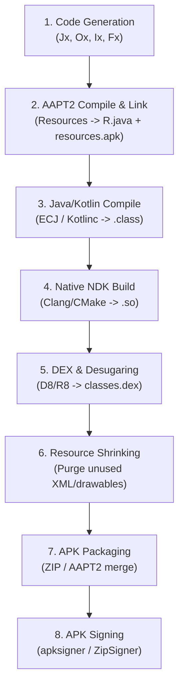

# Sketchware & DayGreen Project System: Complete Architecture Specification

This skill provides an exhaustive, authoritative reference for inspecting, creating, modifying, encrypting, and compiling Sketchware projects (including Sketchware Pro and Sketchware-DayGreen).

---

## 1. Project Storage Root & Directory Hierarchy

All Sketchware data resides under the primary storage root resolved via `a.a.a.wq.getAbsolutePathOf()` (typically `/storage/emulated/0/.sketchware/` on Android devices, or the active workspace path configured in `WorkspaceManager`).

```
/.sketchware/
├── data/
│   ├── system/
│   │   ├── events.json                 <-- Global custom events
│   │   ├── listeners.json              <-- Global custom event listeners
│   │   └── component.json              <-- Global custom components
│   └── <sc_id>/                        <-- Core project data directory (e.g., 601)
│       ├── project                     <-- [ENCRYPTED] Project metadata & configuration
│       ├── file                        <-- [ENCRYPTED] Activity, Fragment & Custom View list
│       ├── logic                       <-- [ENCRYPTED] All blocks, events, variables & functions
│       ├── view                        <-- [ENCRYPTED] View hierarchy & widget properties
│       ├── resource                    <-- [ENCRYPTED] Image, sound, and font registries
│       ├── library                     <-- [ENCRYPTED] Library configurations (AppCompat, Firebase, Supabase)
│       ├── project_config              <-- [PLAINTEXT JSON] Hey Studios / Pro settings (SDKs, build system)
│       ├── DataDayDream.json           <-- [PLAINTEXT JSON] DayDream settings (native C++, activity packages)
│       ├── custom_blocks               <-- [PLAINTEXT JSON] Project-specific custom blocks
│       ├── permission                  <-- [PLAINTEXT] User-declared Android permissions
│       ├── import                      <-- [PLAINTEXT] Global Java imports injected into activities
│       ├── local_library               <-- [PLAINTEXT] Enabled local library names
│       ├── proguard-rules.pro          <-- [PLAINTEXT] Custom ProGuard/R8 rules
│       ├── files/                      <-- Project custom source & asset files
│       │   ├── java/                   <-- Custom Java & Kotlin source files
│       │   ├── assets/                 <-- Custom assets copied directly to APK assets/
│       │   ├── resource/               <-- Custom Android resources (res/values/, res/drawable/, etc.)
│       │   ├── native_libs/            <-- Prebuilt native libraries (armeabi-v7a/, arm64-v8a/, x86/, x86_64/)
│       │   ├── broadcast/              <-- Custom BroadcastReceivers
│       │   ├── service/                <-- Custom Android Services
│       │   └── library/                <-- Project-specific unpacked libraries (jar/, dex/, res/)
│       └── compile_log                 <-- Output log from last compilation attempt
├── mysc/
│   ├── <sc_id>/                        <-- Project cache & display assets
│   │   ├── icon.png                    <-- Project launcher icon
│   │   └── res/                        <-- Sound and temporary project cache
│   └── list/
│       └── <sc_id>/
│           └── project                 <-- [ENCRYPTED] Quick-read project listing metadata
├── bak/
│   └── <sc_id>/                        <-- Unsaved backup directory for active editor sessions
├── resources/                          <-- Global shared resources
│   ├── icons/<sc_id>/                  <-- Project icons
│   ├── images/<sc_id>/                 <-- Project image files
│   ├── sounds/<sc_id>/                 <-- Project audio files
│   ├── fonts/<sc_id>/                  <-- Project TrueType/OpenType font files
│   └── block/
│       └── My Block/
│           ├── block.json              <-- Global custom block definitions
│           └── palette.json            <-- Global custom palette categories
└── libs/
    └── local_libs/                     <-- Global local library repository (unpacked AAR/JARs)
        └── <library_name>/
            ├── classes.jar             <-- Library bytecode JAR
            ├── classes.dex             <-- Pre-dexed bytecode for rapid compilation
            ├── res/                    <-- Library Android resources
            ├── AndroidManifest.xml     <-- Library manifest to merge
            ├── rules.pro               <-- ProGuard rules required by library
            └── jni/                    <-- Native .so libraries
```

---

## 2. Cryptographic Security & AES-128-CBC Specification

Sketchware encrypts its core project data files on disk to prevent manual corruption.

### 2.1 Cipher Details
* **Algorithm**: `AES` (Advanced Encryption Standard, 128-bit key)
* **Mode of Operation**: `CBC` (Cipher Block Chaining)
* **Padding Scheme**: `PKCS5Padding` (PKCS#7 compatible)
* **Secret Key**: `sketchwaresecure` (16 ASCII bytes: `0x73, 0x6b, 0x65, 0x74, 0x63, 0x68, 0x77, 0x61, 0x72, 0x65, 0x73, 0x65, 0x63, 0x75, 0x72, 0x65`)
* **Initialization Vector (IV)**: Identical to the key (`sketchwaresecure`, 16 bytes)

> [!NOTE]
> The encryption key in bytecode (`a.a.a.oB`, `ProjectDecryptor.java`, `BackupFactory.java`, and `crypto.rs`) is `"sketchwaresecure"`. Any tool or script decrypting `.sketchware/data/<sc_id>/` core files must use this exact 16-byte key and IV.

### 2.2 File Classification
| Encrypted (AES-128-CBC) | Plaintext JSON / Text |
| :--- | :--- |
| `data/<sc_id>/project` | `data/<sc_id>/project_config` |
| `data/<sc_id>/file` | `data/<sc_id>/DataDayDream.json` |
| `data/<sc_id>/logic` | `data/<sc_id>/custom_blocks` |
| `data/<sc_id>/view` | `data/<sc_id>/proguard-rules.pro` |
| `data/<sc_id>/resource` | `data/<sc_id>/permission`, `import` |
| `data/<sc_id>/library` | `data/<sc_id>/files/*` (all custom code & assets) |
| `mysc/list/<sc_id>/project` | `data/system/*.json` |

### 2.3 Java Decryption & Encryption Reference
In Java (`a.a.a.oB` / `extensions.anbui.daydream.project.ProjectDecryptor`):

```java
public static String decrypt(byte[] encryptedBytes) throws Exception {
    byte[] key = "sketchwaresecure".getBytes(StandardCharsets.UTF_8);
    Cipher cipher = Cipher.getInstance("AES/CBC/PKCS5Padding");
    cipher.init(Cipher.DECRYPT_MODE, new SecretKeySpec(key, "AES"), new IvParameterSpec(key));
    byte[] decrypted = cipher.doFinal(encryptedBytes);
    return new String(decrypted, StandardCharsets.UTF_8);
}

public static byte[] encrypt(String plainText) throws Exception {
    byte[] key = "sketchwaresecure".getBytes(StandardCharsets.UTF_8);
    Cipher cipher = Cipher.getInstance("AES/CBC/PKCS5Padding");
    cipher.init(Cipher.ENCRYPT_MODE, new SecretKeySpec(key, "AES"), new IvParameterSpec(key));
    return cipher.doFinal(plainText.getBytes(StandardCharsets.UTF_8));
}
```

---

## 3. Project Metadata (`project` & `project_config`)

### 3.1 Core Project Data (`.sketchware/data/<sc_id>/project`)
Decrypted format is a single JSON map:
```json
{
  "sc_id": "601",
  "my_ws_name": "Calculator",
  "my_app_name": "Calculator",
  "my_sc_pkg_name": "com.my.calculator",
  "my_sc_ver_code": "1",
  "my_sc_ver_name": "1.0",
  "sc_ver_code": "1",
  "sc_ver_name": "1.0",
  "color_primary": -16743456,
  "color_primary_dark": -16751424,
  "color_accent": -16728877,
  "color_control_highlight": 1090519039,
  "color_control_normal": -11048043,
  "custom_icon": false,
  "time": 1730900000000,
  "open_time": 1730900000000,
  "proj_type": 1
}
```

> [!CAUTION]
> **Strict String Typing in `project` (ClassCastException Prevention)**:
> In `project`, the version fields `"sc_ver_code"`, `"sc_ver_name"`, `"my_sc_ver_code"`, and `"my_sc_ver_name"` **MUST be formatted as JSON strings** (e.g. `"sc_ver_code": "1"`, never an unquoted integer `1`).
> In Sketchware, `com.besome.sketch.adapters.ProjectsAdapter` (line 129) accesses these fields via `a.a.a.yB.c(projectMap, "sc_ver_code")` which casts `(String) projectMap.get(key)`. If serialized as a raw JSON number, `Gson` parses it into `java.lang.Double`, which immediately causes a fatal crash:
> ```text
> java.lang.ClassCastException: java.lang.Double cannot be cast to java.lang.String
>  at a.a.a.yB.c(dex-id-...:6)
>  at com.besome.sketch.adapters.ProjectsAdapter.onBindViewHolder(ProjectsAdapter.java:129)
> ```
> Always guarantee quotes around version codes and names.

### 3.2 Extended Build Settings (`.sketchware/data/<sc_id>/project_config`)
Plaintext JSON map managed by `mod.hey.studios.project.ProjectSettings`:
```json
{
  "min_sdk": "24",
  "target_sdk": "34",
  "compile_sdk": "34",
  "java_version": "17",
  "build_system": "sketchware",
  "enable_native": "true",
  "enable_viewbinding": "false",
  "enable_bridgeless_themes": "true",
  "disable_old_methods": "true",
  "xml_command": "true",
  "manifest_manual_edit_enabled": "false",
  "universal_dimens": "false",
  "project_template": "1",
  "build_tools_version": "34.0.0",
  "gradle_version": "8.13.1",
  "gradle_agp_version": "8.13.1",
  "gradle_kotlin_version": "1.9.24"
}
```

### 3.3 Auxiliary Configuration Files
Located in `.sketchware/data/<sc_id>/`:

* **`build_config`** (Plaintext JSON):
  Controls compiler engine and JVM target versions:
  ```json
  {
    "dexer": "D8",
    "java_ver": "17",
    "classpath": "",
    "enable_logcat": "false",
    "no_http_legacy": "false",
    "no_warn": "false",
    "android_jar": ""
  }
  ```
* **`view_root`** (Plaintext JSON):
  Customizes the top-level XML root layout element per screen:
  ```json
  {
    "main.xml": {
      "class_name": "LinearLayout",
      "attributes": {
        "android:layout_width": "match_parent",
        "android:layout_height": "match_parent",
        "android:orientation": "vertical"
      }
    }
  }
  ```
* **`stringfog`** (Plaintext JSON): String encryption/obfuscation toggle: `{"enabled": "false"}`.
* **`proguard`** (Plaintext JSON): ProGuard build toggle: `{"enabled": "false", "debug": "false"}`.

---

## 4. Logic File Architecture & Grammar (`logic`)

The `logic` file contains **all logic blocks, event registrations, variables, lists, components, and custom methods** for every screen in the project.

### 4.1 Section Delimiters
When decrypted, the file is partitioned into sections using lines beginning with `@`:
```text
@<JavaName>_var
<type>:<variableName>
...

@<JavaName>_list
<type>:<listName>
...

@<JavaName>_func
<moreBlockName>:<moreBlockSpec>
...

@<JavaName>_components
<ComponentBean JSON>
...

@<JavaName>_events
<EventBean JSON>
...

@<JavaName>_<targetId>_<eventName>
<BlockBean JSON>
<BlockBean JSON>
...
```

For activity events with no specific view target (such as `initializeLogic`, `onBackPressed`), the section header is:
```text
@<JavaName>_onCreate_initializeLogic
@<JavaName>_onBackPressed
```
For view event listeners, the section header includes the view ID:
```text
@<JavaName>_<viewId>_<eventName>
(e.g., @MainActivity.java_button1_onClick)
```

### 4.2 Variables (`@<JavaName>_var`)
Defined as line-separated `type:name` entries (`a.a.a.mq.c`):
* `0`: `boolean` (e.g. `0:isReady`)
* `1`: `double` (number, e.g. `1:counter`)
* `2`: `String` (e.g. `2:userName`)
* `3`: `Map<String, Object>` (e.g. `3:userProfile`)
* `6`: Raw variable / custom field declaration (e.g. `6:private MyCustomClass myCustomVar;`)
* `9`: Custom import injection (e.g. `9:java.util.UUID`)

### 4.3 Lists (`@<JavaName>_list`)
Defined as line-separated `type:name` entries (`a.a.a.mq.b`):
* `1`: `ArrayList<Double>` (number list, e.g. `1:scores`)
* `2`: `ArrayList<String>` (string list, e.g. `2:names`)
* `3`: `ArrayList<HashMap<String, Object>>` (map list, e.g. `3:itemsList`)

### 4.4 MoreBlocks (`@<JavaName>_func`)
Defined as line-separated `name:spec` entries:
```text
calculateTax:calculateTax %d.amount %d.rate
```

### 4.5 Events Registry (`@<JavaName>_events`)
Line-separated `EventBean` JSON objects:
```json
{"eventName":"onClick","eventType":1,"targetId":"button1","targetType":3}
{"eventName":"initializeLogic","eventType":3,"targetId":"","targetType":0}
```
* **`eventType`**:
  * `1`: VIEW event
  * `2`: COMPONENT event
  * `3`: ACTIVITY event
  * `4`: DRAWER_VIEW event
  * `6`: CUSTOM_VIEW event
* **`targetType`**: The integer `viewType` or `componentType` of the target.

### 4.6 Variables & Lists: Operational Specification & Engine Limitations

Sketchware manages activity-scoped variables and lists with strict engine rules enforced by `a.a.a.VB`, `a.a.a.mq`, and `a.a.a.Jx`:

#### 1. Type Mapping & Bytecode Declarations
When building an Activity, `a.a.a.Jx` generates Java field declarations from the decrypted entries:

| Scope | Type ID | In-File Syntax | Generated Java Bytecode / Field Declaration | Notes |
| :--- | :--- | :--- | :--- | :--- |
| **Variable** | `0` | `0:isReady` | `private boolean isReady;` | Default initialized to `false` |
| **Variable** | `1` | `1:counter` | `private double counter;` | **All numbers in Sketchware are `double`**; integers are cast via `(int)(...)` |
| **Variable** | `2` | `2:title` | `private String title = "";` | String instance field |
| **Variable** | `3` | `3:metadata` | `private HashMap<String, Object> metadata = new HashMap<>();` | Key-value dictionary |
| **Variable** | `6` | `6:private MyClass c;` | Directly emitted as class field body | Custom typed field |
| **Variable** | `9` | `9:java.util.UUID` | `import java.util.UUID;` | Injected into top activity imports |
| **List** | `1` | `1:scores` | `private ArrayList<Double> scores = new ArrayList<>();` | Number list; values boxed via `Double.valueOf(...)` |
| **List** | `2` | `2:names` | `private ArrayList<String> names = new ArrayList<>();` | String list |
| **List** | `3` | `3:rows` | `private ArrayList<HashMap<String, Object>> rows = new ArrayList<>();` | Map list for ListViews/RecyclerAdapters |

#### 2. Naming Constraints & Validation Rules (`a.a.a.VB`)
All variable and list identifiers are validated using `Pattern.compile("^[a-zA-Z][a-zA-Z0-9_]*")`:
* **Character 0 Constraint**: The first character **MUST be an ASCII letter** (`A-Z` or `a-z`). It cannot begin with a number or an underscore (`_`).
* **Allowed Characters**: Subsequent characters may only be ASCII letters, numbers `0-9`, and underscores `_`. No spaces or special symbols allowed.
* **Length Limits**: Minimum length is **1 character**; maximum length is **20 characters** (enforced by `a.a.a.VB.java` and `MoreblockValidator.java`).
* **Reserved Keyword Prohibitions (`a.a.a.uq.b`)**:
  Identifiers cannot collide with Java keywords or Sketchware engine symbols (e.g. `abstract`, `boolean`, `break`, `double`, `int`, `String`, `root`, `onCreate`, `onClick`, `LinearLayout`, `R`, `true`, `false`, `none`, `intent`, `timer`, etc.).
* **Unique Namespace Guarantee**:
  A variable cannot share a name with:
  1. Any View ID in the activity (`linear1`, `text1`, `button1`).
  2. Any Component ID in the activity (`timer1`, `sp`, `dialog1`).
  3. Any other variable or list in the same activity.

#### 3. Scope, Lifecycle & State Preservation Limitations
* **Activity-Scoped**: Variables exist only as instance fields of their specific `Activity` class. They are **not global** across screens.
* **Destruction & Volatility**: Variables reset to default values upon Activity finish, screen rotation (if recreation is triggered), or Android OS process termination.
* **Inter-Screen Sharing**: To pass values between screens, always use:
  * `Intent.putExtra(key, value)`
  * `SharedPreferences` component
  * A static Application cache / singleton (`addSourceDirectly`)
* **Floating-Point Arithmetic Limitation**: Because all numbers are `double`, division by zero evaluates to `Double.POSITIVE_INFINITY` or `Double.NaN` rather than throwing `ArithmeticException`. Always check for zero or `Double.isInfinite()` when calculating.

---

## 5. Block JSON Format & Nesting Rules (`BlockBean`)

Each logic block is stored as a single-line JSON object matching `com.besome.sketch.beans.BlockBean`.

### 5.1 JSON Schema
```json
{
  "color": -16354097,
  "id": "10",
  "nextBlock": 11,
  "opCode": "setVisible",
  "parameters": ["textview1", "gone"],
  "spec": "%m.view setVisible %m.visible",
  "subStack1": -1,
  "subStack2": -1,
  "type": " ",
  "typeName": "setVisible"
}
```

### 5.2 Field Specifications
| Field | Type | Description |
| :--- | :--- | :--- |
| `id` | `String` | **Unique block identifier** (e.g. `"10"`, `"11"`). **CRITICAL: NEVER USE `"0"`.** Using `"0"` causes `Validation error: Invalid block id 0`. Always use valid positive integer strings. |
| `color` | `int` | ARGB color integer of the block (e.g. `-16354097` for blue View blocks, `-16729254` for green Math/Operators, `-17842` for orange Control blocks). |
| `nextBlock` | `int` | ID of the next consecutive statement block in the execution chain. Set to `-1` if this is the last block. |
| `opCode` | `String` | The block's operation code (e.g. `setVisible`, `setEnable`, `if`, `ifElse`, `repeat`, `addSourceDirectly`). |
| `parameters`| `Array<String>` | Ordered parameter arguments. See Section 5.3 for literal vs expression syntax. |
| `spec` | `String` | Visual specification template (e.g. `%m.view setVisible %m.visible`). |
| `subStack1` | `int` | Block ID of the **first nested block** (e.g., the `then` body of `if`, the loop body of `repeat`, or listener callbacks). Set to `-1` if empty. |
| `subStack2` | `int` | Block ID of the **second nested block** (e.g., the `else` body of `ifElse`). Set to `-1` if empty. |
| `type` | `String` | Block shape & semantics: `" "` (statement), `"b"` (boolean reporter), `"d"` (number reporter), `"s"` (string reporter), `"c"` (conditional container). |
| `typeName` | `String` | Type name identifier matching the block's operation or return type. |

### 5.3 Expression Embedding via `@<id>`
Reporter and expression blocks (math, boolean conditions, string concatenation) are not chained via `nextBlock`. Instead, they are referenced directly within another block's `parameters` array using the `@` prefix:

```json
{"color":-16354097,"id":"10","nextBlock":-1,"opCode":"setEnable","parameters":["button1","@11"],"spec":"%m.view setEnable %b","subStack1":-1,"subStack2":-1,"type":" ","typeName":"setEnable"}
{"color":-16729254,"id":"11","nextBlock":-1,"opCode":"true","parameters":[],"spec":"true","subStack1":-1,"subStack2":-1,"type":"b","typeName":"true"}
```
Here, `"parameters": ["button1", "@11"]` embeds the boolean reporter block `"11"` into the second argument of block `"10"`.

### 5.4 Control Flow & Nesting Example (`ifElse`)
```json
{"color":-17842,"id":"10","nextBlock":-1,"opCode":"ifElse","parameters":["@11"],"spec":"if %b then %c else %c","subStack1":12,"subStack2":13,"type":"c","typeName":"ifElse"}
{"color":-16729254,"id":"11","nextBlock":-1,"opCode":"booleanAnd","parameters":["@14","@15"],"spec":"%b and %b","subStack1":-1,"subStack2":-1,"type":"b","typeName":"booleanAnd"}
{"color":-16354097,"id":"12","nextBlock":-1,"opCode":"setVisible","parameters":["textview1","visible"],"spec":"%m.view setVisible %m.visible","subStack1":-1,"subStack2":-1,"type":" ","typeName":"setVisible"}
{"color":-16354097,"id":"13","nextBlock":-1,"opCode":"setVisible","parameters":["textview1","gone"],"spec":"%m.view setVisible %m.visible","subStack1":-1,"subStack2":-1,"type":" ","typeName":"setVisible"}
```
* Block `"10"` is an `ifElse` block.
* Parameter `"@11"` points to the condition block (`booleanAnd`).
* `subStack1: 12` points to the `then` branch (`setVisible: visible`).
* `subStack2: 13` points to the `else` branch (`setVisible: gone`).

### 5.5 Event Argument Access (`getArg`)
When an event or MoreBlock provides callback arguments (such as `isChecked` in `onCheckedChange`, `position` in `onItemClick`, or custom parameters in MoreBlocks), blocks retrieve the value using the `getArg` opcode:

```json
{"color":-7711273,"id":"14","nextBlock":-1,"opCode":"getArg","parameters":[],"spec":"isChecked","subStack1":-1,"subStack2":-1,"type":"b","typeName":""}
{"color":-7711273,"id":"13","nextBlock":-1,"opCode":"getArg","parameters":[],"spec":"position","subStack1":-1,"subStack2":-1,"type":"d","typeName":""}
```
* `spec`: Exactly matches the parameter name (e.g. `"isChecked"`, `"position"`, `"value"`).
* `type`: Return type (`"b"` for boolean, `"d"` for number/double, `"s"` for string).
* Can be passed directly via `@<id>` into statement blocks (e.g. `parameters: ["@14"]`).

---

## 6. View & Widget UI System (`view`)

The `view` file defines the visual layout hierarchy for every screen (`.xml` file) in the project.

### 6.1 View File Section Structure
```text
@main.xml
<ViewBean JSON>
<ViewBean JSON>
...

@custom_item.xml
<ViewBean JSON>
...
```

### 6.2 View Type Constants (`ViewBean.java` & `ViewBeans.java`)
| Type ID | Constant | Widget / Layout Class |
| :--- | :--- | :--- |
| `0` | `VIEW_TYPE_LAYOUT_LINEAR` | `android.widget.LinearLayout` |
| `1` | `VIEW_TYPE_LAYOUT_RELATIVE` | `android.widget.RelativeLayout` |
| `2` | `VIEW_TYPE_LAYOUT_HSCROLLVIEW` | `android.widget.HorizontalScrollView` |
| `3` | `VIEW_TYPE_WIDGET_BUTTON` | `android.widget.Button` / `MaterialButton` |
| `4` | `VIEW_TYPE_WIDGET_TEXTVIEW` | `android.widget.TextView` |
| `5` | `VIEW_TYPE_WIDGET_EDITTEXT` | `android.widget.EditText` |
| `6` | `VIEW_TYPE_WIDGET_IMAGEVIEW` | `android.widget.ImageView` |
| `7` | `VIEW_TYPE_WIDGET_WEBVIEW` | `android.webkit.WebView` |
| `8` | `VIEW_TYPE_WIDGET_PROGRESSBAR` | `android.widget.ProgressBar` |
| `9` | `VIEW_TYPE_WIDGET_LISTVIEW` | `android.widget.ListView` |
| `10` | `VIEW_TYPE_WIDGET_SPINNER` | `android.widget.Spinner` |
| `11` | `VIEW_TYPE_WIDGET_CHECKBOX` | `android.widget.CheckBox` |
| `12` | `VIEW_TYPE_LAYOUT_VSCROLLVIEW` | `android.widget.ScrollView` |
| `13` | `VIEW_TYPE_WIDGET_SWITCH` | `android.widget.Switch` |
| `14` | `VIEW_TYPE_WIDGET_SEEKBAR` | `android.widget.SeekBar` |
| `16` | `VIEW_TYPE_WIDGET_FAB` | `FloatingActionButton` |
| `30` | `VIEW_TYPE_LAYOUT_TABLAYOUT` | `TabLayout` |
| `31` | `VIEW_TYPE_LAYOUT_VIEWPAGER` | `ViewPager` |
| `32` | `VIEW_TYPE_LAYOUT_BOTTOMNAVIGATIONVIEW` | `BottomNavigationView` |
| `36` | `VIEW_TYPE_LAYOUT_CARDVIEW` | `CardView` |
| `37` | `VIEW_TYPE_LAYOUT_COLLAPSINGTOOLBARLAYOUT` | `CollapsingToolbarLayout` |
| `38` | `VIEW_TYPE_LAYOUT_TEXTINPUTLAYOUT` | `TextInputLayout` |
| `39` | `VIEW_TYPE_LAYOUT_SWIPEREFRESHLAYOUT` | `SwipeRefreshLayout` |
| `40` | `VIEW_TYPE_LAYOUT_RADIOGROUP` | `RadioGroup` |
| `41` | `VIEW_TYPE_WIDGET_MATERIALBUTTON` | `MaterialButton` |
| `48` | `VIEW_TYPE_WIDGET_RECYCLERVIEW` | `RecyclerView` |
| `49` | `VIEW_TYPE_LAYOUT_VIEWPAGER2` | `ViewPager2` |
| `50` | `VIEW_TYPE_WIDGET_MATERIALSWITCH` | `MaterialSwitch` |
| `158`| `VIEW_TYPE_LAYOUT_CONSTRAINTLAYOUT` | `ConstraintLayout` |
| `163`| `VIEW_TYPE_LAYOUT_FRAMELAYOUT` | `FrameLayout` |

### 6.3 ViewBean JSON Schema
```json
{
  "id": "linear1",
  "type": 0,
  "parent": "root",
  "parentType": -1,
  "index": 0,
  "layout": {
    "width": -1,
    "height": -1,
    "orientation": 1,
    "gravity": 17,
    "layoutGravity": 0,
    "paddingLeft": 16,
    "paddingTop": 16,
    "paddingRight": 16,
    "paddingBottom": 16,
    "marginLeft": 0,
    "marginTop": 0,
    "marginRight": 0,
    "marginBottom": 0,
    "weight": 0,
    "backgroundColor": 0
  }
}
```
Child widgets declare `"parent": "linear1"` and `"index": 0` (or `1`, `2`, etc.) to establish tree structure.

### 6.4 Layout Dimensions
* `-1`: `MATCH_PARENT`
* `-2`: `WRAP_CONTENT`
* `> 0`: Exact density-independent pixel (`dp`) values.

### 6.5 Custom View Subclasses (`convert`) & XML Injection (`inject`)
Sketchware supports binding widgets to custom Java subclasses and injecting custom XML properties:
* **`convert`**: Sets the full qualified Java class name of a custom widget (e.g. `"convert": "com.my.Mbutton.ModernFButton"`). When generating layout XML, Sketchware outputs `<com.my.Mbutton.ModernFButton ...>` instead of the default Android widget tag.
* **`inject`**: Injects raw XML attributes directly into the generated widget element (e.g. `"inject": "android:text=\"Default\" app:cornerRadius=\"12dp\""`). This allows applying custom themes, namespaces, and vendor-specific XML properties without modifying the visual layout editor.

---

## 7. Screen & Activity Definitions (`file`)

The `file` data file stores the list of activities, fragments, and custom view templates.

### 7.1 Schema & Section Delimiters (`ProjectFileBean`)
When decrypted, `file` contains sections partitioned by `@activity` and `@customview`:
```text
@activity
{"fileName":"main","fileType":0,"keyboardSetting":0,"options":9,"orientation":0,"qualifier":""}
{"fileName":"settings","fileType":0,"keyboardSetting":2,"options":1,"orientation":0,"qualifier":""}

@customview
{"fileName":"item_card","fileType":1,"keyboardSetting":0,"options":0,"orientation":0,"qualifier":""}
```

### 7.2 Field Specifications
* **`fileType`**:
  * `0`: Activity (`MainActivity.java`, `main.xml`)
  * `1`: Custom View (`item_card.xml`)
  * `2`: Drawer (`_drawer_main.xml`)
  * `3`: Fragment (`HomeFragment.java`, `home_fragment.xml`)
  * `4`: Bottom Sheet
  * `5`: Dialog Fragment
* **`options`** (Bitmask):
  * `1`: Toolbar (`ActionBar`)
  * `2`: Fullscreen
  * `4`: Navigation Drawer
  * `8`: Floating Action Button (`FAB`)
  * E.g., `options: 9` = Toolbar (1) + FAB (8).
* **`orientation`**: `0` = Portrait, `1` = Landscape, `2` = Sensor/Both.
* **`keyboardSetting`**: `0` = Unspecified, `1` = Visible, `2` = Hidden.
* **`qualifier`**: Resource layout qualifier (e.g. `layout-land`, `layout-sw600dp`).

---

## 8. Component System

Components represent Android system services and third-party libraries (intents, timers, shared preferences, databases).

### 8.1 Component Types (`ComponentBean.java`)
| ID | Constant | Class / Wrapper |
| :--- | :--- | :--- |
| `1` | `COMPONENT_TYPE_INTENT` | `Intent` |
| `2` | `COMPONENT_TYPE_SHAREDPREF` | `SharedPreferences` |
| `3` | `COMPONENT_TYPE_CALENDAR` | `Calendar` |
| `4` | `COMPONENT_TYPE_VIBRATOR` | `Vibrator` |
| `5` | `COMPONENT_TYPE_TIMERTASK` | `Timer` / `TimerTask` |
| `6` | `COMPONENT_TYPE_FIREBASE` | `FirebaseDatabase` |
| `7` | `COMPONENT_TYPE_DIALOG` | `AlertDialog.Builder` |
| `8` | `COMPONENT_TYPE_MEDIAPLAYER` | `MediaPlayer` |
| `9` | `COMPONENT_TYPE_SOUNDPOOL` | `SoundPool` |
| `10`| `COMPONENT_TYPE_OBJECTANIMATOR` | `ObjectAnimator` |
| `12`| `COMPONENT_TYPE_FIREBASE_AUTH` | `FirebaseAuth` |
| `14`| `COMPONENT_TYPE_FIREBASE_STORAGE` | `FirebaseStorage` |
| `17`| `COMPONENT_TYPE_REQUEST_NETWORK` | `RequestNetwork` |
| `26`| `COMPONENT_TYPE_NOTIFICATION` | `NotificationManager` |
| `37`| `COMPONENT_TYPE_SUPABASE_DB` | `SupabaseClient.database` |
| `38`| `COMPONENT_TYPE_SUPABASE_AUTH` | `SupabaseClient.auth` |
| `39`| `COMPONENT_TYPE_SUPABASE_STORAGE` | `SupabaseClient.storage` |

### 8.2 JSON Representation in `@<JavaName>_components`
```json
{"componentId":"intent1","param1":"","param2":"","param3":"","type":1}
{"componentId":"sp","param1":"userData","param2":"","param3":"","type":2}
{"componentId":"timer1","param1":"","param2":"","param3":"","type":5}
{"componentId":"supabaseDb1","param1":"users","param2":"","param3":"","type":37}
```

---

## 9. Resource Management & Vector Graphics (`resource`)

The encrypted `resource` file registers all image, audio, and typography assets used in the project.

### 9.1 Resource File Section Delimiters
When decrypted, the file is partitioned into three sections:
```text
@images
{"resFullName":"iconw.xml","resName":"iconw","resType":1}
{"resFullName":"logo.png","resName":"logo","resType":0}

@sounds
{"resFullName":"beep.mp3","resName":"beep","resType":0}

@fonts
{"resFullName":"poppins_bold.ttf","resName":"poppins_bold","resType":0}
```

### 9.2 Resource Types (`ProjectResourceBean`)
* **`resType: 0`**: Standard bitmap image (PNG/JPG), audio track (MP3/WAV), or font file (TTF/OTF).
* **`resType: 1`**: Android Vector Drawable XML (generated from vector asset importers or SVG conversions).

### 9.3 Vector Asset Import Pipeline (`converted-vectors/`)
When SVG vector drawables are imported into Sketchware:
1. The original vector file is preserved in `.sketchware/data/<sc_id>/converted-vectors/<name>.svg`.
2. Sketchware parses the SVG path data and generates a native Android Vector Drawable XML file saved to `.sketchware/resources/images/<sc_id>/<name>.xml`.
3. An entry is added to `resource` under `@images` with `"resType": 1`.

---

## 10. Library Manager (`library`)

The `library` file defines built-in SDK integrations, partitioned by dedicated section headers:
```text
@firebaseDB
{"adUnits":[],"appId":"","configurations":{},"data":"","libType":0,"reserved1":"","reserved2":"","reserved3":"","testDevices":[],"useYn":"N"}
@compat
{"adUnits":[],"appId":"","configurations":{},"data":"","libType":1,"reserved1":"","reserved2":"","reserved3":"","testDevices":[],"useYn":"Y"}
@admob
{"adUnits":[],"appId":"","configurations":{},"data":"","libType":2,"reserved1":"","reserved2":"","reserved3":"","testDevices":[],"useYn":"N"}
@googleMap
{"adUnits":[],"appId":"","configurations":{},"data":"","libType":3,"reserved1":"","reserved2":"","reserved3":"","testDevices":[],"useYn":"N"}
```
* **`@compat` (`libType: 1`)**: AndroidX AppCompat integration (`useYn: "Y"`).
* **`@firebaseDB` (`libType: 0`)**: Firebase Database & Storage (`reserved1`: API Key, `reserved2`: Database URL, `reserved3`: Bucket, `data`: App ID).
* **`@admob` (`libType: 2`)**: Google AdMob (`adUnits`, `testDevices`).
* **`@googleMap` (`libType: 3`)**: Google Maps SDK (`reserved1`: Maps API Key).
* **`libType: 9`**: Supabase SDK (`useYn: "Y"`, `reserved1`: URL, `reserved2`: Anon Key, `reserved3`: Default Table, `data`: Default Bucket).

---

## 11. DayDream Settings & Native C/C++ (`DataDayDream.json`)

Stored in plaintext JSON at `.sketchware/data/<sc_id>/DataDayDream.json`:
```json
{
  "isEnable": true,
  "enableNative": true,
  "universal_dimens": true,
  "MainActivity": {
    "activityType": "Activity",
    "activityPackage": "com.my.calculator.core",
    "edgeToEdge": true,
    "windowInsetsHandling": true,
    "disableAutomaticPermissionRequests": false
  }
}
```

### Key DayDream Capabilities
1. **Custom Package per Activity**: Sets `activityPackage` to generate activities in distinct subpackages (e.g. `com.my.app.auth.LoginActivity`). `Jx.java` automatically handles package subdirectories and cross-package `R` imports.
2. **Native C/C++ (CMake/NDK)**: When `enableNative: true`, `ProjectBuilder.java` compiles C/C++ source code located in `.sketchware/data/<sc_id>/files/native_libs/` via Clang/LLVM and generates dynamic `CMakeLists.txt` scripts.
3. **Responsive Multi-Qualifier Layouts**: Allows multi-layout definitions for portrait, landscape (`layout-land/`), and tablets (`layout-sw600dp/`, `layout-sw720dp/`) with automatic orientation detection.

---

## 12. Custom Code, Assets & Manifest Injection Paths

Located under `.sketchware/data/<sc_id>/`:

| Path | Purpose | Behavior During Build |
| :--- | :--- | :--- |
| `files/java/` | Custom Java (`.java`) & Kotlin (`.kt`) files | Compiled directly into classpath alongside generated activities. |
| `files/assets/` | Raw assets (fonts, JSON, HTML) | Copied directly into APK `assets/` directory. |
| `files/resource/` | Custom resources (`res/drawable/`, `res/values/`) | Merged with AAPT2 resources before compilation. |
| `files/native_libs/` | Prebuilt `.so` libraries | Packaged into `lib/<abi>/` in the final APK. |
| `files/broadcast/` | Custom BroadcastReceiver classes | Registered in `AndroidManifest.xml`. |
| `files/service/` | Custom Android Service classes | Registered in `AndroidManifest.xml`. |
| `permission` | Custom Android permissions | Appended as `<uses-permission>` tags in `AndroidManifest.xml`. |
| `import` | Global imports | Injected at top of all generated activity Java files. |
| `proguard-rules.pro` | Custom ProGuard / R8 rules | Passed to R8 optimizer and resource shrinker. |
| `custom_blocks` | Custom block definitions | Registered into editor palette and code generator. |

---

## 13. Build & Compilation Pipeline

When a project is built, `a.a.a.ProjectBuilder` executes the following sequence:



### Build Optimization & Safety Safeguards
* **Resource Shrinking (`ResourceShrinker.kt`)**: Analyzes DEX constant pool for `R$*` identifier references and purges unreferenced layout, drawable, and raw resources from `resources.apk`. AAPT2 runs with `--emit-ids` and `--stable-ids` to prevent ID shifting.
* **Duplicate Resource Deduplication**: In `ProjectBuilder.java`, `packagedResourceEntries` deduplicates overlapping library assets (e.g. `src/google/protobuf/any.proto`) using a pickFirst strategy and hashed JAR caches (`filtered_<hash>_<name>.jar`).
* **Essential Runtime Protection**: `android.jar` and `core-lambda-stubs.jar` are strictly retained on the classpath to prevent desugaring crashes under D8.

---

## 14. SWB (`.swb`) Backup Archive Specification & Creation

An `.swb` (Sketchware Backup) file is a standard ZIP archive (Deflate compression) containing a complete snapshot of a project. It is cross-compatible across Sketchware, Sketchware Pro, Sketchware-DayGreen, and Desktop SketchwareX.

### 14.1 Internal Archive File Layout
Inside any valid `.swb` file:

```text
my_project.swb (ZIP Archive)
├── project                         <-- [ENCRYPTED] Root project metadata (AES-128-CBC)
├── data/                           <-- Project data folder
│   ├── file                        <-- [ENCRYPTED] Screen definitions (ProjectFileBean array)
│   ├── view                        <-- [ENCRYPTED] View hierarchy (ViewBean array per screen)
│   ├── logic                       <-- [ENCRYPTED] Logic blocks, events, variables, components
│   ├── resource                    <-- [ENCRYPTED] Resource metadata registry (ProjectResourceBean)
│   ├── library                     <-- [ENCRYPTED] Library toggles (ProjectLibraryBean)
│   ├── project_config              <-- [PLAINTEXT JSON] (Optional) Build & SDK settings
│   ├── DataDayDream.json           <-- [PLAINTEXT JSON] (Optional) DayDream settings
│   ├── custom_blocks               <-- [PLAINTEXT JSON] (Optional) Custom blocks used in project
│   └── files/                      <-- (Optional) Custom source code, assets, native libs
│       ├── java/                   <-- Custom Java/Kotlin source files
│       ├── assets/                 <-- Direct APK assets
│       └── native_libs/            <-- Direct native .so libraries
├── resources/                      <-- Project binary media assets
│   ├── images/                     <-- Project images (PNG, JPG, XML drawables)
│   │   └── .nomedia                <-- Prevents gallery indexing on Android
│   ├── sounds/                     <-- Audio files (MP3, WAV, OGG)
│   │   └── .nomedia
│   ├── fonts/                      <-- Font files (TTF, OTF)
│   │   └── .nomedia
│   └── icons/                      <-- Project launcher icon
│       └── icon.png                <-- App icon
└── local_libs/                     <-- (Optional) Included local AAR/JAR libraries
    └── <library_name>/
        ├── classes.jar
        ├── classes.dex
        ├── res/
        └── AndroidManifest.xml
```

### 14.2 Rules for Creating a Valid `.swb` Archive
1. **Archive Format**: Standard ZIP format with `.swb` extension.
2. **Encryption Boundary**:
   - `project`, `data/file`, `data/view`, `data/logic`, `data/resource`, and `data/library` **MUST be encrypted** using AES-128-CBC PKCS5Padding with key and IV `"sketchwaresecure"`.
   - `project_config`, `DataDayDream.json`, `custom_blocks`, `files/*`, and binary files under `resources/*` **MUST be raw unencrypted plaintext/binary**.
3. **The Root `project` Entry**:
   - Must reside at the archive root (`project`).
   - Contains the encrypted JSON metadata (`my_ws_name`, `my_app_name`, `my_sc_pkg_name`, `my_sc_ver_code`, `my_sc_ver_name`, `sc_id`, `color_primary`, `proj_type: 1`).
4. **Media Separation**:
   - In live storage, project resources reside in `.sketchware/resources/<subfolder>/<sc_id>/...`.
   - When packaging into `.swb`, the `<sc_id>` subfolder is stripped so files reside directly under `resources/images/`, `resources/sounds/`, `resources/fonts/`, and `resources/icons/icon.png`.
   - Each resource folder (except `icons`) must contain an empty `.nomedia` file to prevent Android MediaScanner from polluting the user's gallery.

### 14.3 Programmatic Packaging via Tool (`SwbTool.ps1`)
Use the included tool in `scripts/SwbTool.ps1` to automate packaging and extraction:

```powershell
# Pack a project into an encrypted .swb archive:
powershell -ExecutionPolicy Bypass -File .agents/skills/sketchware-project-system/scripts/SwbTool.ps1 `
    -Action pack `
    -ScId 601 `
    -WorkspaceRoot "C:/path/to/.sketchware" `
    -SwbPath "C:/path/to/backup.swb"

# Unpack and decrypt an .swb archive for inspection:
powershell -ExecutionPolicy Bypass -File .agents/skills/sketchware-project-system/scripts/SwbTool.ps1 `
    -Action unpack `
    -SwbPath "C:/path/to/backup.swb" `
    -OutputDir "C:/path/to/extracted_folder"
```

### 14.4 How Sketchware Restores an `.swb` Archive
When Sketchware restores a backup (`mod.hey.studios.project.backup.BackupFactory` / `BackupCore.java`):
1. **Unzip**: The `.swb` archive is uncompressed into a temporary folder.
2. **ID Allocation**: It inspects existing project IDs in `.sketchware/mysc/list/` and allocates a new available `sc_id` (e.g. `602`).
3. **Project File Mapping**: It decrypts `project`, updates `map.put("sc_id", new_sc_id)`, re-encrypts, and writes to `.sketchware/mysc/list/<new_sc_id>/project` and `.sketchware/data/<new_sc_id>/project`.
4. **Data Sync**: The entire `data/` folder is copied to `.sketchware/data/<new_sc_id>/`.
5. **Asset Migration**: Files from `resources/images/`, `resources/sounds/`, and `resources/fonts/` are copied to `.sketchware/resources/<type>/<new_sc_id>/`.
6. **Icon Restoration**: `resources/icons/icon.png` is copied to `.sketchware/resources/icons/<new_sc_id>/icon.png` and `.sketchware/mysc/<new_sc_id>/icon.png`.
7. **Local Libraries**: If `local_libs/` is present, any libraries not already installed in `.sketchware/libs/local_libs/` are automatically imported.

---

## 15. Limitations, Constraints & Safe Modification Rules

When writing scripts, tools, or direct modifications to Sketchware project files:

> [!CAUTION]
> 1. **NEVER use `"id": 0` or `"id": "0"` for blocks.**
>    Block IDs must always be unique positive integer strings (e.g. `"10"`, `"11"`, `"12"`). Block ID 0 is reserved as invalid and causes immediate validation errors:
>    `NOT_APPROVED: Validation error: Invalid block id 0 in event ...`
> 2. **NEVER attempt Java AST-to-Block reverse engineering.**
>    Converting arbitrary Java syntax trees into blocks is lossy and causes fallbacks to `addSourceDirectly` blocks. Always edit the decrypted `logic` file directly using native JSON block objects.
> 3. **Block Parameters Count Safe Padding (`Fx.java`)**:
>    `Fx.java` expects at least 10 parameter elements for certain opcode evaluations. Missing parameters must be safely padded with empty strings `""` to avoid `IndexOutOfBoundsException`.
> 4. **Java Version Baseline**:
>    Sketchware's built-in ECJ compiler targets Java 8 / Java 11 bytecode. Do not use Java 17+ APIs (such as `InputStream.readAllBytes()`, which requires Android API 33+) unless the target device supports it.
> 5. **Always Re-Encrypt Core Data Files**:
>    Before triggering an editor reload or compilation, all modified core files (`project`, `file`, `logic`, `view`, `resource`, `library`) **MUST** be re-encrypted using AES-128-CBC with key `"sketchwaresecure"`.
> 6. **Strict String Typing for Version Fields in `project` (`ClassCastException` Trap)**:
>    In the `project` JSON file, fields `"sc_ver_code"`, `"sc_ver_name"`, `"my_sc_ver_code"`, and `"my_sc_ver_name"` **MUST be formatted as JSON strings** (`"1"`, not integer `1`).
>    In `ProjectsAdapter.java:129`, Sketchware evaluates `yB.c(projectMap, "sc_ver_code")` which executes `(String) map.get(...)`. Unquoted JSON numbers are parsed by `Gson` as `java.lang.Double`, causing an immediate crash:
>    `java.lang.ClassCastException: java.lang.Double cannot be cast to java.lang.String at com.besome.sketch.adapters.ProjectsAdapter.onBindViewHolder(ProjectsAdapter.java:129)`
> 7. **Variable & List Name Constraints (`a.a.a.VB`)**:
>    All identifiers in `@<JavaName>_var` and `@<JavaName>_list` must strictly match regex `^[a-zA-Z][a-zA-Z0-9_]*` and cannot exceed 20 characters. They cannot begin with numbers or underscores, and cannot collide with the 150+ reserved engine keywords in `a.a.a.uq.b` or existing View IDs.
> 8. **All Numbers Compiled as `double`**:
>    Sketchware's type engine has no primitive `int` variable type. All numeric variables are declared as `private double <name>;`. Division by zero never throws `ArithmeticException` but evaluates to `Double.POSITIVE_INFINITY` or `Double.NaN`.

