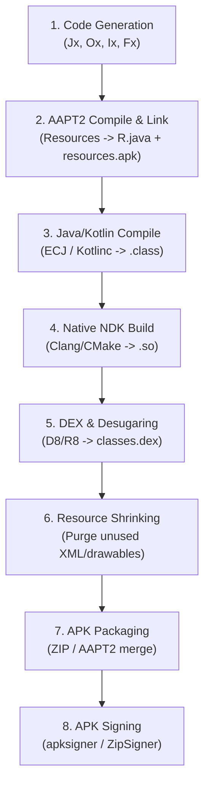

# Sketchware & DayGreen Project System: Complete Architecture Specification

This skill provides an exhaustive, authoritative reference for inspecting, creating, modifying, encrypting, and compiling Sketchware projects (including Sketchware Pro and Sketchware-DayGreen).

---

## 1. Project Storage Root & Directory Hierarchy

All Sketchware data resides under the primary storage root resolved via `a.a.a.wq.getAbsolutePathOf()` (typically `/storage/emulated/0/.sketchware/` on Android devices, or the active workspace path configured in `WorkspaceManager`).

```
/.sketchware/
├── data/
│   ├── system/
│   │   ├── events.json                 <-- Global custom events
│   │   ├── listeners.json              <-- Global custom event listeners
│   │   └── component.json              <-- Global custom components
│   └── <sc_id>/                        <-- Core project data directory (e.g., 601)
│       ├── project                     <-- [ENCRYPTED] Project metadata & configuration
│       ├── file                        <-- [ENCRYPTED] Activity, Fragment & Custom View list
│       ├── logic                       <-- [ENCRYPTED] All blocks, events, variables & functions
│       ├── view                        <-- [ENCRYPTED] View hierarchy & widget properties
│       ├── resource                    <-- [ENCRYPTED] Image, sound, and font registries
│       ├── library                     <-- [ENCRYPTED] Library configurations (AppCompat, Firebase, Supabase)
│       ├── project_config              <-- [PLAINTEXT JSON] Hey Studios / Pro settings (SDKs, build system)
│       ├── DataDayDream.json           <-- [PLAINTEXT JSON] DayDream settings (native C++, activity packages)
│       ├── custom_blocks               <-- [PLAINTEXT JSON] Project-specific custom blocks
│       ├── permission                  <-- [PLAINTEXT] User-declared Android permissions
│       ├── import                      <-- [PLAINTEXT] Global Java imports injected into activities
│       ├── local_library               <-- [PLAINTEXT] Enabled local library names
│       ├── proguard-rules.pro          <-- [PLAINTEXT] Custom ProGuard/R8 rules
│       ├── files/                      <-- Project custom source & asset files
│       │   ├── java/                   <-- Custom Java & Kotlin source files
│       │   ├── assets/                 <-- Custom assets copied directly to APK assets/
│       │   ├── resource/               <-- Custom Android resources (res/values/, res/drawable/, etc.)
│       │   ├── native_libs/            <-- Prebuilt native libraries (armeabi-v7a/, arm64-v8a/, x86/, x86_64/)
│       │   ├── broadcast/              <-- Custom BroadcastReceivers
│       │   ├── service/                <-- Custom Android Services
│       │   └── library/                <-- Project-specific unpacked libraries (jar/, dex/, res/)
│       └── compile_log                 <-- Output log from last compilation attempt
├── mysc/
│   ├── <sc_id>/                        <-- Project cache & display assets
│   │   ├── icon.png                    <-- Project launcher icon
│   │   └── res/                        <-- Sound and temporary project cache
│   └── list/
│       └── <sc_id>/
│           └── project                 <-- [ENCRYPTED] Quick-read project listing metadata
├── bak/
│   └── <sc_id>/                        <-- Unsaved backup directory for active editor sessions
├── resources/                          <-- Global shared resources
│   ├── icons/<sc_id>/                  <-- Project icons
│   ├── images/<sc_id>/                 <-- Project image files
│   ├── sounds/<sc_id>/                 <-- Project audio files
│   ├── fonts/<sc_id>/                  <-- Project TrueType/OpenType font files
│   └── block/
│       └── My Block/
│           ├── block.json              <-- Global custom block definitions
│           └── palette.json            <-- Global custom palette categories
└── libs/
    └── local_libs/                     <-- Global local library repository (unpacked AAR/JARs)
        └── <library_name>/
            ├── classes.jar             <-- Library bytecode JAR
            ├── classes.dex             <-- Pre-dexed bytecode for rapid compilation
            ├── res/                    <-- Library Android resources
            ├── AndroidManifest.xml     <-- Library manifest to merge
            ├── rules.pro               <-- ProGuard rules required by library
            └── jni/                    <-- Native .so libraries
```

---

## 2. Cryptographic Security & AES-128-CBC Specification

Sketchware encrypts its core project data files on disk to prevent manual corruption.

### 2.1 Cipher Details
* **Algorithm**: `AES` (Advanced Encryption Standard, 128-bit key)
* **Mode of Operation**: `CBC` (Cipher Block Chaining)
* **Padding Scheme**: `PKCS5Padding` (PKCS#7 compatible)
* **Secret Key**: `sketchwaresecure` (16 ASCII bytes: `0x73, 0x6b, 0x65, 0x74, 0x63, 0x68, 0x77, 0x61, 0x72, 0x65, 0x73, 0x65, 0x63, 0x75, 0x72, 0x65`)
* **Initialization Vector (IV)**: Identical to the key (`sketchwaresecure`, 16 bytes)

> [!NOTE]
> The encryption key in bytecode (`a.a.a.oB`, `ProjectDecryptor.java`, `BackupFactory.java`, and `crypto.rs`) is `"sketchwaresecure"`. Any tool or script decrypting `.sketchware/data/<sc_id>/` core files must use this exact 16-byte key and IV.

### 2.2 File Classification
| Encrypted (AES-128-CBC) | Plaintext JSON / Text |
| :--- | :--- |
| `data/<sc_id>/project` | `data/<sc_id>/project_config` |
| `data/<sc_id>/file` | `data/<sc_id>/DataDayDream.json` |
| `data/<sc_id>/logic` | `data/<sc_id>/custom_blocks` |
| `data/<sc_id>/view` | `data/<sc_id>/proguard-rules.pro` |
| `data/<sc_id>/resource` | `data/<sc_id>/permission`, `import` |
| `data/<sc_id>/library` | `data/<sc_id>/files/*` (all custom code & assets) |
| `mysc/list/<sc_id>/project` | `data/system/*.json` |

### 2.3 Java Decryption & Encryption Reference
In Java (`a.a.a.oB` / `extensions.anbui.daydream.project.ProjectDecryptor`):

```java
public static String decrypt(byte[] encryptedBytes) throws Exception {
    byte[] key = "sketchwaresecure".getBytes(StandardCharsets.UTF_8);
    Cipher cipher = Cipher.getInstance("AES/CBC/PKCS5Padding");
    cipher.init(Cipher.DECRYPT_MODE, new SecretKeySpec(key, "AES"), new IvParameterSpec(key));
    byte[] decrypted = cipher.doFinal(encryptedBytes);
    return new String(decrypted, StandardCharsets.UTF_8);
}

public static byte[] encrypt(String plainText) throws Exception {
    byte[] key = "sketchwaresecure".getBytes(StandardCharsets.UTF_8);
    Cipher cipher = Cipher.getInstance("AES/CBC/PKCS5Padding");
    cipher.init(Cipher.ENCRYPT_MODE, new SecretKeySpec(key, "AES"), new IvParameterSpec(key));
    return cipher.doFinal(plainText.getBytes(StandardCharsets.UTF_8));
}
```

---

## 3. Project Metadata (`project` & `project_config`)

### 3.1 Core Project Data (`.sketchware/data/<sc_id>/project`)
Decrypted format is a single JSON map:
```json
{
  "sc_id": "601",
  "my_ws_name": "Calculator",
  "my_app_name": "Calculator",
  "my_sc_pkg_name": "com.my.calculator",
  "my_sc_ver_code": "1",
  "my_sc_ver_name": "1.0",
  "sc_ver_code": "1",
  "sc_ver_name": "1.0",
  "color_primary": -16743456,
  "color_primary_dark": -16751424,
  "color_accent": -16728877,
  "color_control_highlight": 1090519039,
  "color_control_normal": -11048043,
  "custom_icon": false,
  "time": 1730900000000,
  "open_time": 1730900000000,
  "proj_type": 1
}
```

> [!CAUTION]
> **Strict String Typing in `project` (ClassCastException Prevention)**:
> In `project`, the version fields `"sc_ver_code"`, `"sc_ver_name"`, `"my_sc_ver_code"`, and `"my_sc_ver_name"` **MUST be formatted as JSON strings** (e.g. `"sc_ver_code": "1"`, never an unquoted integer `1`).
> In Sketchware, `com.besome.sketch.adapters.ProjectsAdapter` (line 129) accesses these fields via `a.a.a.yB.c(projectMap, "sc_ver_code")` which casts `(String) projectMap.get(key)`. If serialized as a raw JSON number, `Gson` parses it into `java.lang.Double`, which immediately causes a fatal crash:
> ```text
> java.lang.ClassCastException: java.lang.Double cannot be cast to java.lang.String
>  at a.a.a.yB.c(dex-id-...:6)
>  at com.besome.sketch.adapters.ProjectsAdapter.onBindViewHolder(ProjectsAdapter.java:129)
> ```
> Always guarantee quotes around version codes and names.

### 3.2 Extended Build Settings (`.sketchware/data/<sc_id>/project_config`)
Plaintext JSON map managed by `mod.hey.studios.project.ProjectSettings`:
```json
{
  "min_sdk": "24",
  "target_sdk": "34",
  "compile_sdk": "34",
  "java_version": "17",
  "build_system": "sketchware",
  "enable_native": "true",
  "enable_viewbinding": "false",
  "enable_bridgeless_themes": "true",
  "disable_old_methods": "true",
  "xml_command": "true",
  "manifest_manual_edit_enabled": "false",
  "universal_dimens": "false",
  "project_template": "1",
  "build_tools_version": "34.0.0",
  "gradle_version": "8.13.1",
  "gradle_agp_version": "8.13.1",
  "gradle_kotlin_version": "1.9.24"
}
```

### 3.3 Auxiliary Configuration Files
Located in `.sketchware/data/<sc_id>/`:

* **`build_config`** (Plaintext JSON):
  Controls compiler engine and JVM target versions:
  ```json
  {
    "dexer": "D8",
    "java_ver": "17",
    "classpath": "",
    "enable_logcat": "false",
    "no_http_legacy": "false",
    "no_warn": "false",
    "android_jar": ""
  }
  ```
* **`view_root`** (Plaintext JSON):
  Customizes the top-level XML root layout element per screen:
  ```json
  {
    "main.xml": {
      "class_name": "LinearLayout",
      "attributes": {
        "android:layout_width": "match_parent",
        "android:layout_height": "match_parent",
        "android:orientation": "vertical"
      }
    }
  }
  ```
* **`stringfog`** (Plaintext JSON): String encryption/obfuscation toggle: `{"enabled": "false"}`.
* **`proguard`** (Plaintext JSON): ProGuard build toggle: `{"enabled": "false", "debug": "false"}`.

---

## 4. Logic File Architecture & Grammar (`logic`)

The `logic` file contains **all logic blocks, event registrations, variables, lists, components, and custom methods** for every screen in the project.

### 4.1 Section Delimiters
When decrypted, the file is partitioned into sections using lines beginning with `@`:
```text
@<JavaName>_var
<type>:<variableName>
...

@<JavaName>_list
<type>:<listName>
...

@<JavaName>_func
<moreBlockName>:<moreBlockSpec>
...

@<JavaName>_components
<ComponentBean JSON>
...

@<JavaName>_events
<EventBean JSON>
...

@<JavaName>_<targetId>_<eventName>
<BlockBean JSON>
<BlockBean JSON>
...
```

For activity events with no specific view target (such as `initializeLogic`, `onBackPressed`), the section header is:
```text
@<JavaName>_onCreate_initializeLogic
@<JavaName>_onBackPressed
```
For view event listeners, the section header includes the view ID:
```text
@<JavaName>_<viewId>_<eventName>
(e.g., @MainActivity.java_button1_onClick)
```

### 4.2 Variables (`@<JavaName>_var`)
Defined as line-separated `type:name` entries (`a.a.a.mq.c`):
* `0`: `boolean` (e.g. `0:isReady`)
* `1`: `double` (number, e.g. `1:counter`)
* `2`: `String` (e.g. `2:userName`)
* `3`: `Map<String, Object>` (e.g. `3:userProfile`)
* `6`: Raw variable / custom field declaration (e.g. `6:private MyCustomClass myCustomVar;`)
* `9`: Custom import injection (e.g. `9:java.util.UUID`)

### 4.3 Lists (`@<JavaName>_list`)
Defined as line-separated `type:name` entries (`a.a.a.mq.b`):
* `1`: `ArrayList<Double>` (number list, e.g. `1:scores`)
* `2`: `ArrayList<String>` (string list, e.g. `2:names`)
* `3`: `ArrayList<HashMap<String, Object>>` (map list, e.g. `3:itemsList`)

### 4.4 MoreBlocks (`@<JavaName>_func`) & Argument Access
MoreBlocks (custom user-defined methods) allow modularizing block logic across an Activity.

#### 1. Registration Syntax (`@<JavaName>_func`)
Defined as line-separated `name:spec` entries:
```text
@MainActivity.java_func
calculateTax:calculateTax %d.amount %d.rate
showCustomToast:showCustomToast %s.message
animateWidget:animateWidget %m.view %d.translationY
```
* **Function Identifier (`name`)**: Valid Java identifier (`^[a-zA-Z][a-zA-Z0-9_]*$`).
* **Specification Template (`spec`)**:
  * Begins with the function name followed by a space and parameter tokens.
  * Supported Parameter Tokens (`a.a.a.mq.a` & `a.a.a.FB.c`):
    * `%b` or `%b.<name>`: `boolean` parameter (Boolean reporter socket)
    * `%d` or `%d.<name>`: `double` / number parameter (Number reporter socket)
    * `%s` or `%s.<name>`: `String` parameter (String reporter socket)
    * `%m.varBool`: Variable Boolean dropdown selector
    * `%m.varInt`: Variable Number dropdown selector
    * `%m.varStr`: Variable String dropdown selector
    * `%m.varMap`: Variable Map dropdown selector
    * `%m.listInt`: List Number dropdown selector
    * `%m.listStr`: List String dropdown selector
    * `%m.listMap`: List Map dropdown selector
    * `%m.view`: Generic View dropdown selector
    * Specific widget selectors: `%m.textview`, `%m.edittext`, `%m.imageview`, `%m.switch`, `%m.checkbox`, `%m.listview`, `%m.spinner`, `%m.webview`
    * Component selectors: `%m.intent`, `%m.file`, `%m.calendar`, `%m.vibrator`, `%m.timer`, `%m.dialog`, `%m.bottomsheet`, `%m.mediaplayer`, `%m.soundpool`, `%m.objectanimator`, `%m.firebase`, `%m.firebaseauth`, `%m.firebasestorage`, `%m.requestnetwork`, `%m.texttospeech`, `%m.speechtotext`, `%m.bluetoothconnect`, `%m.locationmanager`

#### 2. Body Section Delimiter (`@<JavaName>_<funcName>_<funcName>`)
The block definition body for a moreblock resides under its own section:
```text
@MainActivity.java_calculateTax_calculateTax
<BlockBean JSON>
<BlockBean JSON>
```
*(Notice both the targetId and eventName match `<funcName>`)*

#### 3. Reading Arguments Inside MoreBlock Body (`getArg`)
Inside the moreblock's body section, parameters defined in the spec are retrieved using the `getArg` reporter block:
```json
{"color":-8735824,"id":"10","nextBlock":-1,"opCode":"getArg","parameters":[],"spec":"amount","subStack1":-1,"subStack2":-1,"type":"d","typeName":"getArg"}
{"color":-8735824,"id":"11","nextBlock":-1,"opCode":"getArg","parameters":[],"spec":"rate","subStack1":-1,"subStack2":-1,"type":"d","typeName":"getArg"}
```
* **`opCode`**: `"getArg"`.
* **`typeName`**: `"getArg"`.
* **`spec`**: Exactly matches the parameter token name (e.g. `"amount"`, `"rate"`, `"message"`). **Never prefix with `%d.` or `getArg:`!**
* **`parameters`**: Always empty array `[]`.
* **`color`**: `-8735824` (`#7a63b0` purple).
* **`type`**: `"d"` for number, `"s"` for string, `"b"` for boolean, `"v"` for view, `"p"` for component.

#### 4. Invoking MoreBlocks from Other Events (`definedFunc`)
To call a moreblock from `onCreate`, a button click, or any other event, use the `definedFunc` caller block:
```json
{
  "color": -8735824,
  "id": "20",
  "nextBlock": 21,
  "opCode": "definedFunc",
  "parameters": ["1000", "0.15"],
  "spec": "calculateTax %d.amount %d.rate",
  "subStack1": -1,
  "subStack2": -1,
  "type": " ",
  "typeName": ""
}
```
* **`opCode`**: `"definedFunc"`.
* **`spec`**: The exact specification string from `@<JavaName>_func` (e.g. `"calculateTax %d.amount %d.rate"`).
* **`parameters`**: Ordered array of argument values matching each `%` token in the spec. Can be literal values (e.g. `"1000"`, `"Hello"`) or reporter references (e.g. `"@12"`).
* **Java Generation (`Fx.java:286-317`)**: Emits `_calculateTax(1000, 0.15);`. (Note: Sketchware prefixes generated moreblock Java methods with `_`).

### 4.5 Events Registry (`@<JavaName>_events`)
Line-separated `EventBean` JSON objects declaring dynamic view listeners, component callbacks, and optional lifecycle hooks:
```json
{"eventName":"onClick","eventType":1,"targetId":"button1","targetType":3}
{"eventName":"onCheckedChanged","eventType":1,"targetId":"switch1","targetType":13}
{"eventName":"onBackPressed","eventType":3,"targetId":"onBackPressed","targetType":0}
```
* **`eventType`**:
  * `1`: VIEW event
  * `2`: COMPONENT event
  * `3`: ACTIVITY event (optional lifecycle hooks: `onBackPressed`, `onStart`, `onResume`, `onPause`, `onStop`, `onDestroy`, `onCustomMethod`)
  * `4`: DRAWER_VIEW event
  * `6`: CUSTOM_VIEW event
* **`targetType`**: The integer `viewType` or `componentType` of the target (e.g. `3` for Button, `13` for Switch, `0` for Activity).

> [!CAUTION]
> **NEVER Add `initializeLogic` / `onCreate` to `@<JavaName>_events` (Dual onCreate Bug)**:
> In Sketchware, `a.a.a.rs.java` (line 222) **automatically and unconditionally injects `onCreate` (`initializeLogic`) into the Activity Events list** at index 0 when rendering the UI:
> ```java
> EventBean eventBean2 = new EventBean(EventBean.EVENT_TYPE_ACTIVITY, -1, "onCreate", "initializeLogic");
> eventBean2.initValue();
> activityEvents.add(eventBean2);
> ```
> If `@<JavaName>_events` ALSO includes an entry for `initializeLogic` (e.g. `{"eventName":"initializeLogic","eventType":3,...}`), Sketchware loads both the hardcoded built-in entry and the file entry, resulting in **two duplicate `onCreate` ("On activity create") event cards** displayed in the Activity tab!
>
> * **The Rule**: `onCreate` blocks must reside exclusively under the section `@<JavaName>_onCreate_initializeLogic`. **DO NOT add `initializeLogic` to `@<JavaName>_events`.**

### 4.6 Variables & Lists: Operational Specification & Engine Limitations

Sketchware manages activity-scoped variables and lists with strict engine rules enforced by `a.a.a.VB`, `a.a.a.mq`, and `a.a.a.Jx`:

#### 1. Type Mapping & Bytecode Declarations
When building an Activity, `a.a.a.Jx` generates Java field declarations from the decrypted entries:

| Scope | Type ID | In-File Syntax | Generated Java Bytecode / Field Declaration | Notes |
| :--- | :--- | :--- | :--- | :--- |
| **Variable** | `0` | `0:isReady` | `private boolean isReady;` | Default initialized to `false` |
| **Variable** | `1` | `1:counter` | `private double counter;` | **All numbers in Sketchware are `double`**; integers are cast via `(int)(...)` |
| **Variable** | `2` | `2:title` | `private String title = "";` | String instance field |
| **Variable** | `3` | `3:metadata` | `private HashMap<String, Object> metadata = new HashMap<>();` | Key-value dictionary |
| **Variable** | `6` | `6:private MyClass c;` | Directly emitted as class field body | Custom typed field |
| **Variable** | `9` | `9:java.util.UUID` | `import java.util.UUID;` | Injected into top activity imports |
| **List** | `1` | `1:scores` | `private ArrayList<Double> scores = new ArrayList<>();` | Number list; values boxed via `Double.valueOf(...)` |
| **List** | `2` | `2:names` | `private ArrayList<String> names = new ArrayList<>();` | String list |
| **List** | `3` | `3:rows` | `private ArrayList<HashMap<String, Object>> rows = new ArrayList<>();` | Map list for ListViews/RecyclerAdapters |

#### 2. Naming Constraints & Validation Rules (`a.a.a.VB`)
All variable and list identifiers are validated using `Pattern.compile("^[a-zA-Z][a-zA-Z0-9_]*")`:
* **Character 0 Constraint**: The first character **MUST be an ASCII letter** (`A-Z` or `a-z`). It cannot begin with a number or an underscore (`_`).
* **Allowed Characters**: Subsequent characters may only be ASCII letters, numbers `0-9`, and underscores `_`. No spaces or special symbols allowed.
* **Length Limits**: Minimum length is **1 character**; maximum length is **20 characters** (enforced by `a.a.a.VB.java` and `MoreblockValidator.java`).
* **Reserved Keyword Prohibitions (`a.a.a.uq.b`)**:
  Identifiers cannot collide with Java keywords or Sketchware engine symbols (e.g. `abstract`, `boolean`, `break`, `double`, `int`, `String`, `root`, `onCreate`, `onClick`, `LinearLayout`, `R`, `true`, `false`, `none`, `intent`, `timer`, etc.).
* **Unique Namespace Guarantee**:
  A variable cannot share a name with:
  1. Any View ID in the activity (`linear1`, `text1`, `button1`).
  2. Any Component ID in the activity (`timer1`, `sp`, `dialog1`).
  3. Any other variable or list in the same activity.

#### 3. Scope, Lifecycle & State Preservation Limitations
* **Activity-Scoped**: Variables exist only as instance fields of their specific `Activity` class. They are **not global** across screens.
* **Destruction & Volatility**: Variables reset to default values upon Activity finish, screen rotation (if recreation is triggered), or Android OS process termination.
* **Inter-Screen Sharing**: To pass values between screens, always use:
  * `Intent.putExtra(key, value)`
  * `SharedPreferences` component
  * A static Application cache / singleton (`addSourceDirectly`)
* **Floating-Point Arithmetic Limitation**: Because all numbers are `double`, division by zero evaluates to `Double.POSITIVE_INFINITY` or `Double.NaN` rather than throwing `ArithmeticException`. Always check for zero or `Double.isInfinite()` when calculating.

---

## 5. Block JSON Format & Nesting Rules (`BlockBean`)

Each logic block is stored as a single-line JSON object matching `com.besome.sketch.beans.BlockBean`.

### 5.1 JSON Schema
```json
{
  "color": -16354097,
  "id": "10",
  "nextBlock": 11,
  "opCode": "setVisible",
  "parameters": ["textview1", "gone"],
  "spec": "%m.view setVisible %m.visible",
  "subStack1": -1,
  "subStack2": -1,
  "type": " ",
  "typeName": "setVisible"
}
```

### 5.2 Field Specifications
| Field | Type | Description |
| :--- | :--- | :--- |
| `id` | `String` | **Unique block identifier** (e.g. `"10"`, `"11"`). **CRITICAL: NEVER USE `"0"`.** Using `"0"` causes `Validation error: Invalid block id 0`. Always use valid positive integer strings. |
| `color` | `int` | ARGB color integer of the block (e.g. `-16354097` for blue View blocks, `-16729254` for green Math/Operators, `-17842` for orange Control blocks). |
| `nextBlock` | `int` | ID of the next consecutive statement block in the execution chain. Set to `-1` if this is the last block. |
| `opCode` | `String` | The block's operation code (e.g. `setVisible`, `setEnable`, `if`, `ifElse`, `repeat`, `addSourceDirectly`). |
| `parameters`| `Array<String>` | Ordered parameter arguments. See Section 5.3 for literal vs expression syntax. |
| `spec` | `String` | Visual specification template (e.g. `%m.view setVisible %m.visible`). |
| `subStack1` | `int` | Block ID of the **first nested block** (e.g., the `then` body of `if`, the loop body of `repeat`, or listener callbacks). Set to `-1` if empty. |
| `subStack2` | `int` | Block ID of the **second nested block** (e.g., the `else` body of `ifElse`). Set to `-1` if empty. |
| `type` | `String` | Block shape & semantics: `" "` (statement), `"b"` (boolean reporter), `"d"` (number reporter), `"s"` (string reporter), `"c"` (conditional container). |
| `typeName` | `String` | Type name identifier matching the block's operation or return type. |

### 5.3 Expression Embedding via `@<id>`
Reporter and expression blocks (math, boolean conditions, string concatenation) are not chained via `nextBlock`. Instead, they are referenced directly within another block's `parameters` array using the `@` prefix:

```json
{"color":-16354097,"id":"10","nextBlock":-1,"opCode":"setEnable","parameters":["button1","@11"],"spec":"%m.view setEnable %b","subStack1":-1,"subStack2":-1,"type":" ","typeName":"setEnable"}
{"color":-16729254,"id":"11","nextBlock":-1,"opCode":"true","parameters":[],"spec":"true","subStack1":-1,"subStack2":-1,"type":"b","typeName":"true"}
```
Here, `"parameters": ["button1", "@11"]` embeds the boolean reporter block `"11"` into the second argument of block `"10"`.

### 5.4 Chainable Control Flow (`if`, `elseIf`, `else`)
In Sketchware Pro and DayGreen, control flow is constructed as a linear chain of C-type container blocks (`type: "c"`, `color: -1988054` / `#e1a92a`) connected sequentially via `nextBlock`, rather than nested `ifElse` structures:

```json
{"color":-1988054,"id":"10","nextBlock":12,"opCode":"if","parameters":["@11"],"spec":"if %b then","subStack1":13,"subStack2":-1,"type":"c","typeName":"if"}
{"color":-16729254,"id":"11","nextBlock":-1,"opCode":"=","parameters":["@14","0"],"spec":"%d = %d","subStack1":-1,"subStack2":-1,"type":"b","typeName":"="}
{"color":-16354097,"id":"13","nextBlock":-1,"opCode":"setText","parameters":["textview1","n is zero"],"spec":"%m.textview setText %s","subStack1":-1,"subStack2":-1,"type":" ","typeName":"setText"}
{"color":-1988054,"id":"12","nextBlock":16,"opCode":"elseIf","parameters":["@15"],"spec":"else if %b","subStack1":17,"subStack2":-1,"type":"c","typeName":"elseIf"}
{"color":-16729254,"id":"15","nextBlock":-1,"opCode":">","parameters":["@18","0"],"spec":"%d > %d","subStack1":-1,"subStack2":-1,"type":"b","typeName":">"}
{"color":-16354097,"id":"17","nextBlock":-1,"opCode":"setText","parameters":["textview1","n is positive"],"spec":"%m.textview setText %s","subStack1":-1,"subStack2":-1,"type":" ","typeName":"setText"}
{"color":-1988054,"id":"16","nextBlock":-1,"opCode":"else","parameters":[],"spec":"else","subStack1":19,"subStack2":-1,"type":"c","typeName":"else"}
{"color":-16354097,"id":"19","nextBlock":-1,"opCode":"setText","parameters":["textview1","n is negative"],"spec":"%m.textview setText %s","subStack1":-1,"subStack2":-1,"type":" ","typeName":"setText"}
```
* **Linear Connection**: `if` (id: 10) connects to `elseIf` (id: 12) via `nextBlock: 12`. `elseIf` connects to `else` (id: 16) via `nextBlock: 16`.
* **SubStacks**: Each branch has its own execution body contained entirely inside `subStack1`. `subStack2` is always `-1`.
* **Parameters**: `if` and `elseIf` take a single condition parameter (`["@<cond_id>"]`). `else` takes no parameters (`[]`).

### 5.5 Variable Reporter Blocks (`getVar`)
When referencing a declared variable inside an expression, Math operation, or setter block, the reporter block must use the exact variable name as its `spec` without any prefix:

```json
{"color":-2389760,"id":"14","nextBlock":-1,"opCode":"getVar","parameters":[],"spec":"n","subStack1":-1,"subStack2":-1,"type":"d","typeName":"getVar"}
```
* **`spec`**: Exactly the variable name (e.g. `"n"`, `"count"`, `"title"`). **NEVER use `"getVar: n"` or `"%m.varInt"` in the spec.** Setting `spec` to the variable name causes Sketchware to render cleanly as `( n )` instead of `( getVar : n )`.
* **`parameters`**: Always an empty array `[]`.
* **`opCode` & `typeName`**: Both set to `"getVar"`.
* **`color`**: `-2389760` (`#ee7d16` orange).
* **`type`**: `"d"` for number/double, `"s"` for String, `"b"` for boolean, `"a"` for Map.

### 5.6 Source-Emitting Comment Blocks (`addSourceDirectlyIf`)
Standard Sketchware `comment` blocks (`opCode: "comment"` or `"line_comment"`) are ignored during compilation by `a.a.a.Fx.java` and do NOT appear in the final generated Java source code.

To emit real comments into the compiled Java code, always use the C-type `addSourceDirectlyIf` block:

```json
{"color":-10701022,"id":"10","nextBlock":11,"opCode":"addSourceDirectlyIf","parameters":["// Initialize user session and state"],"spec":"add source directly %s.inputOnly","subStack1":-1,"subStack2":-1,"type":"c","typeName":"addSourceDirectlyIf"}
```
* **`opCode`**: `"addSourceDirectlyIf"`.
* **`type`**: `"c"` (C-type container block shape).
* **`color`**: `-10701022` (`#5cb722` green).
* **`spec`**: `"add source directly %s.inputOnly"`.
* **`parameters`**: Array containing the comment text starting with `// ` or `/* ` (e.g. `["// comment text"]`).
* **Source Generation**: `Fx.java:602-604` detects that parameter 0 starts with `//` or `/*` and outputs the comment line directly into the activity's Java code.

### 5.7 Event Argument Access (`getArg`)
When an event or MoreBlock provides callback arguments (such as `isChecked` in `onCheckedChange`, `position` in `onItemClick`, or custom parameters in MoreBlocks), blocks retrieve the value using the `getArg` opcode:

```json
{"color":-8735824,"id":"14","nextBlock":-1,"opCode":"getArg","parameters":[],"spec":"isChecked","subStack1":-1,"subStack2":-1,"type":"b","typeName":"getArg"}
{"color":-8735824,"id":"13","nextBlock":-1,"opCode":"getArg","parameters":[],"spec":"position","subStack1":-1,"subStack2":-1,"type":"d","typeName":"getArg"}
```
* `spec`: Exactly matches the parameter name (e.g. `"isChecked"`, `"position"`, `"value"`).
* `type`: Return type (`"b"` for boolean, `"d"` for number/double, `"s"` for string).
* Can be passed directly via `@<id>` into statement blocks (e.g. `parameters: ["@14"]`).

### 5.8 Logic Insertion vs Replacement Rules
When modifying an event's blocks:

* **Default Behavior: Append / Insert Mode (`replace: false`)**:
  - When the user asks to "add", "insert", or "append" logic (e.g., "add a timer", "handle click to open screen"), **NEVER wipe out existing event blocks**.
  - `LogicTools.insertLogicBlocks` resolves existing blocks automatically:
    1. Determines `maxExistingId` across existing blocks.
    2. Re-indexes incoming block IDs with `idOffset = maxExistingId + 10` to avoid ID collisions.
    3. Remaps all internal connections (`nextBlock`, `subStack1`, `subStack2`, and expression references `@<id>`).
    4. Walks the existing root chain to locate the terminal block (`nextBlock == -1`).
    5. Sets `tailBlock.nextBlock = firstIncomingId`, cleanly attaching the new logic to the end of the existing chain.
* **Explicit Override: Replacement Mode (`replace: true`)**:
  - ONLY pass `replace: true` if the user explicitly states: "replace all blocks", "clear and rewrite event", "reset logic", or "overwrite event".

---

## 6. View & Widget UI System (`view`)

The `view` file defines the visual layout hierarchy for every screen (`.xml` file) in the project. When decrypted, it is partitioned into sections using lines beginning with `@`.

### 6.1 View File Section Structure & Qualifiers
```text
@main.xml
<ViewBean JSON>
<ViewBean JSON>
...

@main.xml_fab
<ViewBean JSON (type 16, id "_fab")>

@main-land.xml
<ViewBean JSON>
...

@main-land.xml_fab
<ViewBean JSON>

@custom_item.xml
<ViewBean JSON>
...
```

* **`@<screen>.xml`**: Base layout for an Activity or Custom View.
* **`@<screen>.xml_fab`**: Dedicated Floating Action Button section (`id: "_fab"`, `type: 16`), present when the activity's FAB option is enabled (`options: 8`).
* **`@<screen>-<qualifier>.xml`**: **Responsive Layout Variant (SketchwareX / DayGreen Only)**. Contains the alternate view tree for landscape (`-land`), tablets (`-sw600dp`, `-sw720dp`), or large/foldable displays (`-w840dp`).

### 6.2 View Type Constants (`ViewBean.java` & `ViewBeans.java`)
| Type ID | Constant | Widget / Class | Default `convert` Value |
| :---: | :--- | :--- | :--- |
| `0` | `VIEW_TYPE_LAYOUT_LINEAR` | `android.widget.LinearLayout` | `""` or `"LinearLayout"` |
| `1` | `VIEW_TYPE_LAYOUT_RELATIVE` | `android.widget.RelativeLayout` | `"RelativeLayout"` |
| `2` | `VIEW_TYPE_LAYOUT_HSCROLLVIEW` | `android.widget.HorizontalScrollView` | `"HorizontalScrollView"` |
| `3` | `VIEW_TYPE_WIDGET_BUTTON` | `android.widget.Button` | `"Button"` |
| `4` | `VIEW_TYPE_WIDGET_TEXTVIEW` | `android.widget.TextView` | `"TextView"` |
| `5` | `VIEW_TYPE_WIDGET_EDITTEXT` | `android.widget.EditText` | `"EditText"` |
| `6` | `VIEW_TYPE_WIDGET_IMAGEVIEW` | `android.widget.ImageView` | `"ImageView"` |
| `7` | `VIEW_TYPE_WIDGET_WEBVIEW` | `android.webkit.WebView` | `"WebView"` |
| `8` | `VIEW_TYPE_WIDGET_PROGRESSBAR` | `android.widget.ProgressBar` | `"ProgressBar"` |
| `9` | `VIEW_TYPE_WIDGET_LISTVIEW` | `android.widget.ListView` | `"ListView"` |
| `10` | `VIEW_TYPE_WIDGET_SPINNER` | `android.widget.Spinner` | `"Spinner"` |
| `11` | `VIEW_TYPE_WIDGET_CHECKBOX` | `android.widget.CheckBox` | `"CheckBox"` |
| `12` | `VIEW_TYPE_LAYOUT_VSCROLLVIEW` | `android.widget.ScrollView` | `"ScrollView"` |
| `13` | `VIEW_TYPE_WIDGET_SWITCH` | `android.widget.Switch` | `"Switch"` |
| `14` | `VIEW_TYPE_WIDGET_SEEKBAR` | `android.widget.SeekBar` | `"SeekBar"` |
| `15` | `VIEW_TYPE_WIDGET_CALENDARVIEW`| `android.widget.CalendarView` | `"CalendarView"` |
| `16` | `VIEW_TYPE_WIDGET_FAB` | `com.google.android.material.floatingactionbutton.FloatingActionButton` | `""` |
| `30` | `VIEW_TYPE_LAYOUT_TABLAYOUT` | `com.google.android.material.tabs.TabLayout` | `"com.google.android.material.tabs.TabLayout"` |
| `31` | `VIEW_TYPE_LAYOUT_VIEWPAGER` | `androidx.viewpager.widget.ViewPager` | `"androidx.viewpager.widget.ViewPager"` |
| `32` | `VIEW_TYPE_LAYOUT_BOTTOMNAVIGATIONVIEW` | `BottomNavigationView` | `"com.google.android.material.bottomnavigation.BottomNavigationView"` |
| `36` | `VIEW_TYPE_LAYOUT_CARDVIEW` | `androidx.cardview.widget.CardView` | `"androidx.cardview.widget.CardView"` |
| `37` | `VIEW_TYPE_LAYOUT_COLLAPSINGTOOLBARLAYOUT` | `CollapsingToolbarLayout` | `"com.google.android.material.appbar.CollapsingToolbarLayout"` |
| `38` | `VIEW_TYPE_LAYOUT_TEXTINPUTLAYOUT` | `TextInputLayout` | `"com.google.android.material.textfield.TextInputLayout"` |
| `39` | `VIEW_TYPE_LAYOUT_SWIPEREFRESHLAYOUT` | `SwipeRefreshLayout` | `"androidx.swiperefreshlayout.widget.SwipeRefreshLayout"` |
| `40` | `VIEW_TYPE_LAYOUT_RADIOGROUP` | `android.widget.RadioGroup` | `"RadioGroup"` |
| `41` | `VIEW_TYPE_WIDGET_MATERIALBUTTON` | `MaterialButton` | `"com.google.android.material.button.MaterialButton"` |
| `48` | `VIEW_TYPE_WIDGET_RECYCLERVIEW` | `androidx.recyclerview.widget.RecyclerView` | `"androidx.recyclerview.widget.RecyclerView"` |
| `49` | `VIEW_TYPE_LAYOUT_VIEWPAGER2` | `androidx.viewpager2.widget.ViewPager2` | `"androidx.viewpager2.widget.ViewPager2"` |
| `50` | `VIEW_TYPE_WIDGET_MATERIALSWITCH` | `MaterialSwitch` | `"com.google.android.material.materialswitch.MaterialSwitch"` |
| `158`| `VIEW_TYPE_LAYOUT_CONSTRAINTLAYOUT` | `ConstraintLayout` | `"androidx.constraintlayout.widget.ConstraintLayout"` |
| `163`| `VIEW_TYPE_LAYOUT_FRAMELAYOUT` | `android.widget.FrameLayout` | `"FrameLayout"` |

### 6.2.1 The `convert` and `inject` Operational Mechanics
* **`convert` (Custom Class Substitution)**:
  In SketchwareX layout XML compilation, `convert` specifies the exact class used as the XML element tag.
  - For standard Android widgets, `convert` contains the simple or fully qualified class name: `"LinearLayout"`, `"TextView"`, `"Button"`, `"EditText"`, `"ImageView"`, `"Switch"`, etc.
  - For Material 3 & AndroidX widgets, `convert` MUST be set to the component's full classpath:
    - MaterialButton (`type: 41`): `convert: "com.google.android.material.button.MaterialButton"`
    - CardView / MaterialCardView (`type: 36`): `convert: "androidx.cardview.widget.CardView"`
    - MaterialSwitch (`type: 50`): `convert: "com.google.android.material.materialswitch.MaterialSwitch"`
    - ViewPager2 (`type: 49`): `convert: "androidx.viewpager2.widget.ViewPager2"`
    - RecyclerView (`type: 48`): `convert: "androidx.recyclerview.widget.RecyclerView"`
    - FloatingActionButton (`type: 16`): `convert: ""`
* **`inject` (Direct XML Attribute Injection)**:
  `inject` contains raw XML attribute declarations inserted verbatim into the generated XML opening tag during compilation.
  - Attributes must follow standard Android XML syntax: `namespace:attribute="value"`.
  - Common patterns:
    - CardView rounded corners and elevation: `inject: "app:cardCornerRadius=\"16dp\" app:cardElevation=\"4dp\""`
    - MaterialButton rounded corner: `inject: "app:cornerRadius=\"8dp\""`
    - MaterialButton icon: `inject: "app:icon=\"@drawable/ic_heart\" app:iconGravity=\"textStart\""`

### 6.3 Complete ViewBean Real-World JSON Schema
Each widget is serialized as a single compact JSON line:
```json
{
  "id": "cardview1",
  "type": 36,
  "parent": "linear1",
  "parentType": 0,
  "index": 0,
  "preIndex": 0,
  "preParentType": 0,
  "parentAttributes": {},
  "convert": "androidx.cardview.widget.CardView",
  "inject": "app:cardElevation=\"4dp\"\napp:cardCornerRadius=\"16dp\"",
  "customView": "",
  "clickable": 1,
  "enabled": 1,
  "checked": 0,
  "choiceMode": 0,
  "dividerHeight": 1,
  "firstDayOfWeek": 1,
  "indeterminate": "false",
  "max": 100,
  "progress": 0,
  "progressStyle": "?android:progressBarStyle",
  "alpha": 1.0,
  "scaleX": 1.0,
  "scaleY": 1.0,
  "translationX": 0.0,
  "translationY": 0.0,
  "spinnerMode": 1,
  "adSize": "",
  "adUnitId": "",
  "layout": {
    "width": -1,
    "height": -2,
    "orientation": 1,
    "gravity": 0,
    "layoutGravity": 0,
    "paddingLeft": 8,
    "paddingTop": 8,
    "paddingRight": 8,
    "paddingBottom": 8,
    "marginLeft": 0,
    "marginTop": 0,
    "marginRight": 0,
    "marginBottom": 16,
    "weight": 0,
    "weightSum": 0,
    "backgroundColor": 16777215,
    "backgroundResColor": "",
    "borderColor": -16740915
  },
  "text": {
    "text": "Card Title",
    "textSize": 16,
    "textColor": -16777216,
    "textFont": "default_font",
    "textType": 1,
    "hint": "",
    "hintColor": -10453621,
    "singleLine": 0,
    "line": 0,
    "inputType": 1,
    "imeOption": 0
  },
  "image": {
    "rotate": 0,
    "scaleType": "CENTER"
  }
}
```

### 6.4 Hierarchy & Tree Structure
* **`parent`**:
  * `"root"`: Topmost root view of the screen.
  * `<viewId>`: ID of the parent ViewGroup container (e.g. `"linear1"`, `"cardview1"`).
* **`parentType`**: Type ID of the parent ViewGroup (`0` for LinearLayout, `36` for CardView, `163` for FrameLayout, `-1` for root).
* **`index`**: Zero-based positional child index within the parent container.

### 6.5 Layout Geometry, Padding & Dimensions
* **`width` & `height`**:
  * `-1`: `MATCH_PARENT`
  * `-2`: `WRAP_CONTENT`
  * `0`: Used in combination with `weight > 0` for proportional sizing.
  * `> 0`: Explicit size in density-independent pixels (`dp`).
* **`paddingLeft`, `paddingTop`, `paddingRight`, `paddingBottom`**:
  * Measured in `dp`.
  * **CardView Automatic Translation (`Ox.java:850`)**: For `CardView` (`type: 36`), Sketchware automatically routes padding values to `app:contentPadding` (if uniform) or `app:contentPaddingLeft`, `app:contentPaddingTop`, etc.
* **`orientation`**: `0` = Horizontal, `1` = Vertical, `-1` = None (for non-linear containers).
* **`gravity` & `layoutGravity`** (Bitmask constants):
  * `0`: `NONE`
  * `1`: `CENTER_HORIZONTAL`
  * `3`: `LEFT`
  * `5`: `RIGHT`
  * `16`: `CENTER_VERTICAL`
  * `17`: `CENTER` (`1 | 16`)
  * `48`: `TOP`
  * `80`: `BOTTOM`
  * `85`: `BOTTOM | RIGHT` (`80 | 5`)
* **`backgroundColor`**:
  * `16777215` (`0x00FFFFFF`): Transparent / Default theme surface.
  * Signed 32-bit ARGB integer for custom colors (e.g. `-1` for `#FFFFFF`, `-16777216` for `#000000`, `-15461356` for dark surface).

### 6.6 Custom View Subclasses (`convert`)
The `convert` field allows binding any widget to an arbitrary custom class or AndroidX component:

1. **XML Tag Generation (`a.a.a.Ox.java:419`)**:
   ```java
   XmlBuilder widgetTag = convert.isEmpty() ? new XmlBuilder(viewBean.getClassInfo().getClassName()) :
           new XmlBuilder(convert.replace(" ", ""));
   ```
   * If `convert` is set to `"androidx.cardview.widget.CardView"`, the XML tag emits:
     `<androidx.cardview.widget.CardView ...>`
   * If `convert` is set to `"include"`, Sketchware emits an include tag:
     `<include layout="@layout/<id>" .../>`
2. **Java Class Field & Import Generation (`a.a.a.Jx.java:850`)**:
   Sketchware extracts the simple class name using `WIDGET_NAME_PATTERN`:
   * For `"androidx.cardview.widget.CardView"`:
     Emits: `private CardView cardview1;` and adds `import androidx.cardview.widget.CardView;`.
   * For `"com.google.android.material.button.MaterialButton"`:
     Emits: `private MaterialButton button1;` and adds `import com.google.android.material.button.MaterialButton;`.

### 6.7 Raw XML Attribute Injection (`inject`)
The `inject` property allows directly adding raw XML attributes into the generated widget element:

* **Engine Parser (`pro.sketchware.utility.InjectAttributeHandler.java`)**:
  Sketchware parses `inject` using `XmlPullParser` with `xmlns:android`, `xmlns:app`, and `xmlns:tools` namespaces automatically bound.
* **Syntax**: Attributes separated by newline `\n` with escaped quotes (`\"` or unicode `\u003d` for `=`):
  ```text
  "inject": "app:cardElevation=\"4dp\"\napp:cardCornerRadius=\"16dp\"\napp:strokeWidth=\"1dp\""
  ```
* **Attribute Override & Deduplication**:
  Attributes present in `inject` automatically suppress Sketchware's default generated attributes. For example, injecting `android:orientation="horizontal"` overrides the default orientation without duplicate attribute errors.

### 6.8 Responsive Layout System (SketchwareX / DayGreen Only)

> [!IMPORTANT]
> **SketchwareX Exclusive Feature**:
> Standard Sketchware and Sketchware Pro **DO NOT** support responsive qualifiers. Only **SketchwareX / DayGreen** supports multi-qualifier layouts in `data/view` and the visual layout switcher.

#### Qualifier Partitioning in `data/view`:
In SketchwareX, responsive variants are saved directly in the project `view` file using qualifier section tags:

```text
@main.xml
# Base portrait / default layout

@main-land.xml
# Landscape orientation variant (res/layout-land/main.xml)

@main-sw600dp.xml
# 7-inch tablets variant (res/layout-sw600dp/main.xml)

@main-sw720dp.xml
# 10-inch tablets variant (res/layout-sw720dp/main.xml)

@main-w840dp.xml
# Foldables and large desktop displays (res/layout-w840dp/main.xml)
```

#### How SketchwareX Compiles Responsive Layouts:
1. `file` registers each variant with its `qualifier` property in `ProjectFileBean` (e.g. `"qualifier": "-land"`).
2. During APK compilation, `a.a.a.ProjectBuilder` reads each section and writes the generated XML into the corresponding Android resource directory:
   * `@main.xml` -> `res/layout/main.xml`
   * `@main-land.xml` -> `res/layout-land/main.xml`
   * `@main-sw600dp.xml` -> `res/layout-sw600dp/main.xml`
3. At runtime, the Android framework automatically inflates the matching layout based on device orientation or screen dimensions without any manual Java code!

### 6.9 In-Place Layout Mutation (`update_widget`) vs Destructive Removal

> [!CAUTION]
> **Never remove and re-add widgets to modify their attributes!**
> In Sketchware, `removeWidget` cascades through all child descendants and removes them permanently. More critically, deleting a widget breaks all connected event listeners (e.g. `button1_onClick` in `@MainActivity.java_events`), causing "Widget not found in this layout: button1" and crashing the editor with `NullPointerException` when opened!

To modify any widget attribute (dimensions, margins, padding, convert class, XML attribute injection, text, hints, or background):
* **Always use `update_widget`**: Modifies the `ViewBean` in-place while keeping its unique ID, parent container binding, child hierarchy, and attached event handlers completely intact.
* **Preserve Untouched Properties**: When updating properties like `inject` or `padding`, properties not specified in the update payload (such as `text` or `hint`) are strictly retained.

### 6.10 Color Rules & AAPT2 Error Prevention

> [!CAUTION]
> **STRICT PROHIBITION: Never Emit Bare or Incomplete `@color/ ` References!**
> In Sketchware layouts and raw attribute injection (`inject`), writing empty or unclosed color references such as `android:textColor="@color/ "` or `app:cardBackgroundColor="@color/"` crashes the build immediately during AAPT2 resource linking:
> ```text
> error: failed to resolve resource '@color/'
> AAPT: error: invalid resource directory name or failed to resolve resource '@color/'
> ```
> Layout tools and AI agents must strictly follow valid color specifications:

#### Valid Color Formats:
1. **Hexadecimal Notation (Recommended)**:
   * 8-digit ARGB: `#FFFFFFFF` (white), `#FF121212` (dark surface), `#FF6200EE` (purple), `#FF000000` (black).
   * 6-digit RGB: `#FFFFFF`, `#121212`, `#6200EE`, `#000000`.
2. **Signed 32-bit Integer ARGB (`backgroundColor`, `textColor`)**:
   * White: `-1` (`0xFFFFFFFF`)
   * Black: `-16777216` (`0xFF000000`)
   * Transparent: `16777215` (`0x00FFFFFF`)
   * Dark Surface: `-15461356` (`0xFF141414`)
   * Orange: `-2389760` (`0xFFEE7D16`)
3. **Material Theme Attributes**:
   * `?attr/colorPrimary`
   * `?attr/colorOnPrimary`
   * `?attr/colorSurface`
   * `?attr/colorOnSurface`
   * `?attr/colorSecondary`
   * `?attr/colorOutline`
4. **Standard Android Framework Colors**:
   * `@android:color/white`
   * `@android:color/black`
   * `@android:color/transparent`
5. **Project Color Resources (`@color/<name>`)**:
   * ONLY use `@color/<name>` if `<name>` is already declared in `res/values/colors.xml`.
   * Never invent or guess non-existent color resource names. If unsure, always default to a hex code (`#FFFFFF`) or theme attribute (`?attr/colorPrimary`).

---

## 7. Screen & Activity Definitions (`file`)

The `file` data file stores the list of activities, fragments, and custom view templates.

### 7.1 Schema & Section Delimiters (`ProjectFileBean`)
When decrypted, `file` contains sections partitioned by `@activity` and `@customview`:
```text
@activity
{"fileName":"main","fileType":0,"keyboardSetting":0,"options":9,"orientation":0,"qualifier":""}
{"fileName":"settings","fileType":0,"keyboardSetting":2,"options":1,"orientation":0,"qualifier":""}

@customview
{"fileName":"item_card","fileType":1,"keyboardSetting":0,"options":0,"orientation":0,"qualifier":""}
```

### 7.2 Field Specifications
* **`fileType`**:
  * `0`: Activity (`MainActivity.java`, `main.xml`)
  * `1`: Custom View (`item_card.xml`)
  * `2`: Drawer (`_drawer_main.xml`)
  * `3`: Fragment (`HomeFragment.java`, `home_fragment.xml`)
  * `4`: Bottom Sheet
  * `5`: Dialog Fragment
* **`options`** (Bitmask):
  * `1`: Toolbar (`ActionBar`)
  * `2`: Fullscreen
  * `4`: Navigation Drawer
  * `8`: Floating Action Button (`FAB`)
  * E.g., `options: 9` = Toolbar (1) + FAB (8).
* **`orientation`**: `0` = Portrait, `1` = Landscape, `2` = Sensor/Both.
* **`keyboardSetting`**: `0` = Unspecified, `1` = Visible, `2` = Hidden.
* **`qualifier`**: Resource layout qualifier (e.g. `layout-land`, `layout-sw600dp`).

---

## 8. Exhaustive Component System Reference

Components represent Android framework system services, architecture primitives, and SDK integrations (intents, timers, shared preferences, databases, sensors).

### 8.1 Complete Component Types Directory (`ComponentBean.java` & `a.a.a.mq`)

| ID | Constant | Type Name (`mq.a`) | Default Var Prefix | Wrapper / Android Class | `param1` / `param2` / `param3` Definition |
| :---: | :--- | :--- | :---: | :--- | :--- |
| `1` | `COMPONENT_TYPE_INTENT` | `Intent` | `i` | `android.content.Intent` | `""` |
| `2` | `COMPONENT_TYPE_SHAREDPREF` | `SharedPreferences` | `sp` | `android.content.SharedPreferences` | `param1`: File name (e.g. `"userData"`) |
| `3` | `COMPONENT_TYPE_CALENDAR` | `Calendar` | `cal` | `java.util.Calendar` | `""` |
| `4` | `COMPONENT_TYPE_VIBRATOR` | `Vibrator` | `vib` | `android.os.Vibrator` | `""` |
| `5` | `COMPONENT_TYPE_TIMERTASK` | `Timer` | `tim` | `java.util.Timer` | `""` |
| `6` | `COMPONENT_TYPE_FIREBASE` | `FirebaseDB` | `fdb` | `com.google.firebase.database.DatabaseReference` | `param1`: Root path (e.g. `"users"`) |
| `7` | `COMPONENT_TYPE_DIALOG` | `Dialog` | `dil` | `android.app.AlertDialog.Builder` | `""` |
| `8` | `COMPONENT_TYPE_MEDIAPLAYER` | `MediaPlayer` | `mp` | `android.media.MediaPlayer` | `""` |
| `9` | `COMPONENT_TYPE_SOUNDPOOL` | `SoundPool` | `spool` | `android.media.SoundPool` | `param1`: maxStreams (e.g. `"5"`), `param2`: quality (`"0"`) |
| `10`| `COMPONENT_TYPE_OBJECTANIMATOR` | `ObjectAnimator` | `oa` | `android.animation.ObjectAnimator` | `""` |
| `11`| `COMPONENT_TYPE_GYROSCOPE` | `Gyroscope` | `gyro` | `android.hardware.SensorManager` | `""` |
| `12`| `COMPONENT_TYPE_FIREBASE_AUTH` | `FirebaseAuth` | `fauth` | `com.google.firebase.auth.FirebaseAuth` | `""` |
| `13`| `COMPONENT_TYPE_INTERSTITIAL_AD` | `InterstitialAd` | `ad` | `com.google.android.gms.ads.interstitial.InterstitialAd`| `""` |
| `14`| `COMPONENT_TYPE_FIREBASE_STORAGE`| `FirebaseStorage` | `fstore` | `com.google.firebase.storage.StorageReference` | `param1`: Bucket URL (e.g. `"gs://app.appspot.com"`) |
| `15`| `COMPONENT_TYPE_CAMERA` | `Camera` | `camera` | `android.content.Intent` (MediaStore) | `""` |
| `16`| `COMPONENT_TYPE_FILE_PICKER` | `FilePicker` | `filepicker` | `android.content.Intent` (GET_CONTENT) | `param1`: MIME type filter (e.g. `"*/*"`, `"image/*"`) |
| `17`| `COMPONENT_TYPE_REQUEST_NETWORK` | `RequestNetwork` | `net` | `pro.sketchware.utility.RequestNetwork` | `""` |
| `18`| `COMPONENT_TYPE_TEXT_TO_SPEECH` | `TextToSpeech` | `tts` | `android.speech.tts.TextToSpeech` | `""` |
| `19`| `COMPONENT_TYPE_SPEECH_TO_TEXT` | `SpeechToText` | `stt` | `android.speech.SpeechRecognizer` | `""` |
| `20`| `COMPONENT_TYPE_BLUETOOTH_CONNECT`| `BluetoothConnect` | `bt` | `android.bluetooth.BluetoothAdapter` | `""` |
| `21`| `COMPONENT_TYPE_LOCATION_MANAGER` | `LocationManager` | `loc` | `android.location.LocationManager` | `""` |
| `22`| `COMPONENT_TYPE_REWARDED_VIDEO_AD`| `RewardedVideoAd` | `r_ad` | `com.google.android.gms.ads.rewarded.RewardedAd` | `""` |
| `23`| `COMPONENT_TYPE_PROGRESS_DIALOG` | `ProgressDialog` | `pd` | `android.app.ProgressDialog` | `""` |
| `24`| `COMPONENT_TYPE_DATE_PICKER_DIALOG`| `DatePickerDialog`| `dpd` | `android.app.DatePickerDialog` | `""` |
| `25`| `COMPONENT_TYPE_TIME_PICKER_DIALOG`| `TimePickerDialog`| `tpd` | `android.app.TimePickerDialog` | `""` |
| `26`| `COMPONENT_TYPE_NOTIFICATION` | `Notification` | `notif` | `android.app.NotificationManager` | `""` |
| `27`| `COMPONENT_TYPE_FRAGMENT_ADAPTER` | `FragmentStatePagerAdapter` | `fa` | `androidx.fragment.app.FragmentStatePagerAdapter` | `""` |
| `28`| `COMPONENT_TYPE_FIREBASE_AUTH_PHONE`| `FirebasePhoneAuth` | `phoneauth` | `com.google.firebase.auth.PhoneAuthProvider` | `""` |
| `30`| `COMPONENT_TYPE_FIREBASE_CLOUD_MESSAGE`| `FirebaseCloudMessage` | `fcm` | `com.google.firebase.messaging.FirebaseMessaging` | `""` |
| `31`| `COMPONENT_TYPE_FIREBASE_AUTH_GOOGLE_LOGIN`| `GoogleSignInClient` | `googlelogin` | `com.google.android.gms.auth.api.signin.GoogleSignInClient` | `""` |
| `32`| `COMPONENT_TYPE_UNITY_ADS` | `UnityAds` | `unityads` | `com.unity3d.ads.UnityAds` | `param1`: Game ID, `param2`: Test mode (`"true"`/`"false"`) |
| `37`| `COMPONENT_TYPE_SUPABASE_DB` | `SupabaseDB` | `supabaseDb` | `io.github.jan.supabase.postgrest.Postgrest` | `param1`: Default table name |
| `38`| `COMPONENT_TYPE_SUPABASE_AUTH` | `SupabaseAuth` | `supabaseAuth` | `io.github.jan.supabase.gotrue.Auth` | `""` |
| `39`| `COMPONENT_TYPE_SUPABASE_STORAGE`| `SupabaseStorage` | `supabaseStorage` | `io.github.jan.supabase.storage.Storage` | `param1`: Default storage bucket name |
| `40`| `COMPONENT_TYPE_BOTTOM_SHEET_DIALOG`| `BottomSheetDialog` | `bsd` | `com.google.android.material.bottomsheet.BottomSheetDialog` | `""` |

### 8.2 JSON Format in `@<JavaName>_components`
Stored as compact, line-separated JSON objects:
```json
{"componentId":"i","param1":"","param2":"","param3":"","type":1}
{"componentId":"sp","param1":"userData","param2":"","param3":"","type":2}
{"componentId":"tim","param1":"","param2":"","param3":"","type":5}
{"componentId":"dil","param1":"","param2":"","param3":"","type":7}
{"componentId":"bsd","param1":"","param2":"","param3":"","type":40}
{"componentId":"fdb","param1":"chat_rooms","param2":"","param3":"","type":6}
{"componentId":"net","param1":"","param2":"","param3":"","type":17}
{"componentId":"supabaseDb1","param1":"profiles","param2":"","param3":"","type":37}
```

### 8.3 Exhaustive Block opCodes, Specs & Parameters

#### 1. Intent (`type: 1`, prefix `i`)
* **`intentSetAction`**: `spec: "%m.intent setAction %m.intentAction"`, `parameters: ["i", "ACTION_VIEW"]`
* **`intentSetData`**: `spec: "%m.intent setData %s"`, `parameters: ["i", "https://example.com"]`
* **`intentSetScreen`**: `spec: "%m.intent setScreen %m.screen"`, `parameters: ["i", "DetailActivity"]`
* **`intentPutExtra`**: `spec: "%m.intent putExtra key %s value %s"`, `parameters: ["i", "userId", "12345"]`
* **`intentSetFlags`**: `spec: "%m.intent setFlags %m.intentFlags"`, `parameters: ["i", "CLEAR_TOP"]`
* **`intentGetString`**: `spec: "%m.intent getStringExtra %s"`, `parameters: ["userId"]`, `type: "s"`
* **`startActivity`**: `spec: "startActivity %m.intent"`, `parameters: ["i"]`
* **`finishActivity`**: `spec: "finishActivity"`, `parameters: []`

#### 2. SharedPreferences / File (`type: 2`, prefix `sp`)
* **`fileSetData`**: `spec: "%m.file setData key %s value %s"`, `parameters: ["sp", "key", "val"]`
* **`fileGetData`**: `spec: "%m.file getData key %s"`, `parameters: ["sp", "key"]`, `type: "s"`
* **`fileRemoveData`**: `spec: "%m.file removeData key %s"`, `parameters: ["sp", "key"]`

#### 3. Calendar (`type: 3`, prefix `cal`)
* **`calendarGetNow`**: `spec: "%m.calendar getNow"`, `parameters: ["cal"]`
* **`calendarAdd`**: `spec: "%m.calendar add %m.calendarField value %d"`, `parameters: ["cal", "DATE", "1"]`
* **`calendarSet`**: `spec: "%m.calendar set %m.calendarField value %d"`, `parameters: ["cal", "HOUR_OF_DAY", "12"]`
* **`calendarFormat`**: `spec: "%m.calendar Format %s"`, `parameters: ["cal", "yyyy-MM-dd HH:mm:ss"]`, `type: "s"`
* **`calendarDiff`**: `spec: "%m.calendar diff %m.calendar"`, `parameters: ["cal1", "cal2"]`, `type: "d"`
* **`calendarGetTime`**: `spec: "%m.calendar getTime"`, `parameters: ["cal"]`, `type: "d"`
* **`calendarSetTime`**: `spec: "%m.calendar setTime %d"`, `parameters: ["cal", "1730000000000"]`

#### 4. Vibrator (`type: 4`, prefix `vib`)
* **`vibratorAction`**: `spec: "%m.vibrator action %d ms"`, `parameters: ["vib", "500"]`

#### 5. Timer (`type: 5`, prefix `tim`)
* **`timerEvery`**: `spec: "%m.timer after %d ms for every %d ms"`, `parameters: ["tim", "1000", "1000"]`, `type: "c"`, body logic nested in `subStack1`
* **`timerAfter`**: `spec: "%m.timer after %d ms"`, `parameters: ["tim", "2000"]`, `type: "c"`, body logic nested in `subStack1`
* **`timerCancel`**: `spec: "%m.timer cancel"`, `parameters: ["tim"]`

#### 6. Dialog (`type: 7`, prefix `dil`)
* **`dialogSetTitle`**: `spec: "%m.dialog setTitle %s"`, `parameters: ["dil", "Dialog Title"]`
* **`dialogSetMessage`**: `spec: "%m.dialog setMessage %s"`, `parameters: ["dil", "Dialog message content"]`
* **`dialogOkButton`**: `spec: "%m.dialog OK Button %s clicked"`, `parameters: ["dil", "OK"]`, `type: "c"`, click actions in `subStack1`
* **`dialogCancelButton`**: `spec: "%m.dialog Cancel Button %s clicked"`, `parameters: ["dil", "Cancel"]`, `type: "c"`, click actions in `subStack1`
* **`dialogNeutralButton`**: `spec: "%m.dialog Neutral Button %s clicked"`, `parameters: ["dil", "Later"]`, `type: "c"`, click actions in `subStack1`
* **`dialogShow`**: `spec: "%m.dialog show"`, `parameters: ["dil"]`
* **`dialogDismiss`**: `spec: "%m.dialog dismiss"`, `parameters: ["dil"]`
* **`dialogConvertToMaterial3`**: `spec: "%m.dialog convertToMaterial3"`, `parameters: ["dil"]`
* **`dialogSetCustomView`**: `spec: "%m.dialog setCustomView %m.view"`, `parameters: ["dil", "linear1"]`

#### 7. BottomSheetDialog (`type: 40`, prefix `bsd`)
* **`bottomSheetSetCustomView`**: `spec: "%m.bottomsheet setCustomView %m.view"`, `parameters: ["bsd", "linear1"]`
* **`bottomSheetShow`**: `spec: "%m.bottomsheet show"`, `parameters: ["bsd"]`
* **`bottomSheetDismiss`**: `spec: "%m.bottomsheet dismiss"`, `parameters: ["bsd"]`
* **`bottomSheetSetCancelable`**: `spec: "%m.bottomsheet setCancelable %b"`, `parameters: ["bsd", "true"]`
* **`bottomSheetSetState`**: `spec: "%m.bottomsheet setState %m.bottomsheetState"`, `parameters: ["bsd", "EXPANDED"]`
* **`bottomSheetSetPeekHeight`**: `spec: "%m.bottomsheet setPeekHeight %d"`, `parameters: ["bsd", "320"]`
* **`bottomSheetOnDismiss`**: `spec: "%m.bottomsheet onDismiss"`, `parameters: ["bsd"]`, `type: "c"`, logic in `subStack1`
* **`bottomSheetOnStateChanged`**: `spec: "%m.bottomsheet onStateChanged"`, `parameters: ["bsd"]`, `type: "c"`, logic in `subStack1`

#### 8. MediaPlayer (`type: 8`, prefix `mp`)
* **`mediaplayerCreate`**: `spec: "%m.mediaplayer create %m.sound"`, `parameters: ["mp", "track"]`
* **`mediaplayerStart`**: `spec: "%m.mediaplayer start"`, `parameters: ["mp"]`
* **`mediaplayerPause`**: `spec: "%m.mediaplayer pause"`, `parameters: ["mp"]`
* **`mediaplayerSeek`**: `spec: "%m.mediaplayer seekTo %d"`, `parameters: ["mp", "5000"]`
* **`mediaplayerGetCurrent`**: `spec: "%m.mediaplayer getCurrentPosition"`, `parameters: ["mp"]`, `type: "d"`
* **`mediaplayerGetDuration`**: `spec: "%m.mediaplayer getDuration"`, `parameters: ["mp"]`, `type: "d"`
* **`mediaplayerIsPlaying`**: `spec: "%m.mediaplayer isPlaying"`, `parameters: ["mp"]`, `type: "b"`
* **`mediaplayerSetLooping`**: `spec: "%m.mediaplayer setLooping %b"`, `parameters: ["mp", "true"]`
* **`mediaplayerReset`**: `spec: "%m.mediaplayer reset"`, `parameters: ["mp"]`
* **`mediaplayerRelease`**: `spec: "%m.mediaplayer release"`, `parameters: ["mp"]`

#### 9. SoundPool (`type: 9`, prefix `spool`)
* **`soundpoolCreate`**: `spec: "%m.soundpool create maxStreams %d"`, `parameters: ["spool", "5"]`
* **`soundpoolLoad`**: `spec: "%m.soundpool load %m.sound"`, `parameters: ["spool", "click"]`, `type: "d"`
* **`soundpoolStreamPlay`**: `spec: "%m.soundpool play soundId %d loop %d"`, `parameters: ["spool", "@10", "0"]`
* **`soundpoolStreamStop`**: `spec: "%m.soundpool stop streamId %d"`, `parameters: ["spool", "@10"]`

#### 10. ObjectAnimator (`type: 10`, prefix `oa`)
* **`objectanimatorSetTarget`**: `spec: "%m.objectanimator setTarget %m.view"`, `parameters: ["oa", "button1"]`
* **`objectanimatorSetProperty`**: `spec: "%m.objectanimator setProperty %m.animProperty"`, `parameters: ["oa", "TRANSLATION_Y"]`
* **`objectanimatorSetValue`**: `spec: "%m.objectanimator setValue %d"`, `parameters: ["oa", "100"]`
* **`objectanimatorSetFromTo`**: `spec: "%m.objectanimator setFrom %d to %d"`, `parameters: ["oa", "0", "100"]`
* **`objectanimatorSetDuration`**: `spec: "%m.objectanimator setDuration %d"`, `parameters: ["oa", "300"]`
* **`objectanimatorSetRepeatMode`**: `spec: "%m.objectanimator setRepeatMode %m.animRepeat"`, `parameters: ["oa", "RESTART"]`
* **`objectanimatorSetRepeatCount`**: `spec: "%m.objectanimator setRepeatCount %d"`, `parameters: ["oa", "1"]`
* **`objectanimatorSetInterpolator`**: `spec: "%m.objectanimator setInterpolator %m.animInterpolator"`, `parameters: ["oa", "AccelerateDecelerate"]`
* **`objectanimatorStart`**: `spec: "%m.objectanimator start"`, `parameters: ["oa"]`
* **`objectanimatorCancel`**: `spec: "%m.objectanimator cancel"`, `parameters: ["oa"]`
* **`objectanimatorIsRunning`**: `spec: "%m.objectanimator isRunning"`, `parameters: ["oa"]`, `type: "b"`

#### 11. RequestNetwork (`type: 17`, prefix `net`)
* **`requestnetworkSetParams`**: `spec: "%m.requestnetwork setParams %m.varMap type %m.reqType"`, `parameters: ["net", "paramsMap", "REQUEST_PARAM"]`
* **`requestnetworkSetHeaders`**: `spec: "%m.requestnetwork setHeaders %m.varMap"`, `parameters: ["net", "headersMap"]`
* **`requestnetworkStartRequestNetwork`**: `spec: "%m.requestnetwork startRequest method %m.reqMethod url %s tag %s"`, `parameters: ["net", "GET", "https://api.example.com/items", "ITEMS_REQ"]`

#### 12. TextToSpeech & SpeechToText (`type: 18` & `19`, prefix `tts` & `stt`)
* **`textToSpeechSpeak`**: `spec: "%m.texttospeech speak %s"`, `parameters: ["tts", "Operation completed"]`
* **`textToSpeechSetPitch`**: `spec: "%m.texttospeech setPitch %d"`, `parameters: ["tts", "1.0"]`
* **`textToSpeechSetSpeechRate`**: `spec: "%m.texttospeech setSpeechRate %d"`, `parameters: ["tts", "1.0"]`
* **`textToSpeechStop`**: `spec: "%m.texttospeech stop"`, `parameters: ["tts"]`
* **`speechToTextStartListening`**: `spec: "%m.speechtotext startListening"`, `parameters: ["stt"]`
* **`speechToTextStopListening`**: `spec: "%m.speechtotext stopListening"`, `parameters: ["stt"]`

#### 13. Firebase Suite (`type: 6, 12, 14`)
* **`firebaseAdd`**: `spec: "%m.firebase child %s updateChildren %m.varMap"`, `parameters: ["fdb", "users/101", "userMap"]`
* **`firebasePush`**: `spec: "%m.firebase push %m.varMap"`, `parameters: ["fdb", "userMap"]`
* **`firebaseGetPushKey`**: `spec: "%m.firebase getPushKey"`, `parameters: ["fdb"]`, `type: "s"`
* **`firebaseDelete`**: `spec: "%m.firebase child %s removeValue"`, `parameters: ["fdb", "users/101"]`
* **`firebaseGetChildren`**: `spec: "%m.firebase getChildren %m.listMap"`, `parameters: ["fdb", "usersList"]`, `type: "c"`, completion logic in `subStack1`
* **`firebaseStartListen`**: `spec: "%m.firebase startListen"`, `parameters: ["fdb"]`
* **`firebaseStopListen`**: `spec: "%m.firebase stopListen"`, `parameters: ["fdb"]`
* **`firebaseauthCreateUser`**: `spec: "%m.firebaseauth createUserWithEmail %s password %s"`, `parameters: ["fauth", "email@test.com", "pass1234"]`
* **`firebaseauthSignInUser`**: `spec: "%m.firebaseauth signInWithEmail %s password %s"`, `parameters: ["fauth", "email@test.com", "pass1234"]`
* **`firebaseauthSignOutUser`**: `spec: "%m.firebaseauth signOut"`, `parameters: []`
* **`firebaseauthIsLoggedIn`**: `spec: "%m.firebaseauth isLoggedIn"`, `parameters: []`, `type: "b"`
* **`firebaseauthGetCurrentUser`**: `spec: "%m.firebaseauth getCurrentUser"`, `parameters: []`, `type: "s"`
* **`firebaseauthGetUid`**: `spec: "%m.firebaseauth getUid"`, `parameters: []`, `type: "s"`
* **`firebasestorageUploadFile`**: `spec: "%m.firebasestorage child %s putFile %s"`, `parameters: ["fstore", "profile.png", "local/profile.png"]`
* **`firebasestorageDownloadFile`**: `spec: "%m.firebasestorage getReferenceFromUrl %s getFile %s"`, `parameters: ["fstore", "gs://bucket/file.png", "local/file.png"]`
* **`firebasestorageDelete`**: `spec: "%m.firebasestorage delete %s"`, `parameters: ["fstore", "gs://bucket/file.png"]`

---

## 9. Resource Management & Vector Graphics (`resource`)

The encrypted `resource` file registers all image, audio, and typography assets used in the project.

### 9.1 Resource File Section Delimiters
When decrypted, the file is partitioned into three sections:
```text
@images
{"resFullName":"iconw.xml","resName":"iconw","resType":1}
{"resFullName":"logo.png","resName":"logo","resType":0}

@sounds
{"resFullName":"beep.mp3","resName":"beep","resType":0}

@fonts
{"resFullName":"poppins_bold.ttf","resName":"poppins_bold","resType":0}
```

### 9.2 Resource Types (`ProjectResourceBean`)
* **`resType: 0`**: Standard bitmap image (PNG/JPG), audio track (MP3/WAV), or font file (TTF/OTF).
* **`resType: 1`**: Android Vector Drawable XML (generated from vector asset importers or SVG conversions).

### 9.3 Vector Asset Import Pipeline (`converted-vectors/`)
When SVG vector drawables are imported into Sketchware:
1. The original vector file is preserved in `.sketchware/data/<sc_id>/converted-vectors/<name>.svg`.
2. Sketchware parses the SVG path data and generates a native Android Vector Drawable XML file saved to `.sketchware/resources/images/<sc_id>/<name>.xml`.
3. An entry is added to `resource` under `@images` with `"resType": 1`.

### 9.4 String Resources & Localization (`res/values/strings.xml`)

Sketchware-DayGreen features a dedicated **Strings Tab** (`StringsEditorFragment.java`) and persistent multi-locale strings architecture managed by `org.sketchware.daygreen.editor.strings.StringsRepository` and `pro.sketchware.utility.ProjectStrings`.

#### 9.4.1 File Hierarchy & Locales
String resources reside on disk in plaintext standard Android XML format under `.sketchware/data/<sc_id>/files/resource/`:
```text
files/resource/
├── values/
│   └── strings.xml             <-- Default language / baseline strings
├── values-ar/
│   └── strings.xml             <-- Arabic translation
├── values-es/
│   └── strings.xml             <-- Spanish translation
└── values-fr/
    └── strings.xml             <-- French translation
```

#### 9.4.2 Structure of `strings.xml`
```xml
<?xml version="1.0" encoding="utf-8"?>
<resources>
    <string name="app_name">Tap Counter</string>
    <string name="button1_text">Click Me</string>
    <string name="textview1_text" translatable="false">Count: 0</string>
</resources>
```
* **`app_name`**: Mandatory string resource for every project. Defines the application label in `AndroidManifest.xml`.
* **`translatable="false"`**: Marked as untranslatable in localized resource folders.

#### 9.4.3 Binding to Widgets (`@string/<key>`)
Every widget's text, hint, or content description can reference a string resource:
* In `ViewBean.text.text`: Set to `"@string/<key>"` (e.g. `"@string/app_name"` or `"@string/button1_text"`).
* **Automatic Externalization**: When literal text is assigned to a widget, `ProjectStrings.assign(...)` automatically registers `<widgetId>_text` in `values/strings.xml` and binds `"@string/<widgetId>_text"` to the widget.
* **Strict Preservation Rule**: When modifying widget properties with AI or tools, if a widget already references `"@string/<key>"`, that reference must be strictly preserved! Never replace an existing `@string/...` reference with a hardcoded string literal unless the user explicitly requested modifying that specific text string.

---

## 10. Library Manager (`library`)

The `library` file defines built-in SDK integrations, partitioned by dedicated section headers:
```text
@firebaseDB
{"adUnits":[],"appId":"","configurations":{},"data":"","libType":0,"reserved1":"","reserved2":"","reserved3":"","testDevices":[],"useYn":"N"}
@compat
{"adUnits":[],"appId":"","configurations":{},"data":"","libType":1,"reserved1":"","reserved2":"","reserved3":"","testDevices":[],"useYn":"Y"}
@admob
{"adUnits":[],"appId":"","configurations":{},"data":"","libType":2,"reserved1":"","reserved2":"","reserved3":"","testDevices":[],"useYn":"N"}
@googleMap
{"adUnits":[],"appId":"","configurations":{},"data":"","libType":3,"reserved1":"","reserved2":"","reserved3":"","testDevices":[],"useYn":"N"}
```
* **`@compat` (`libType: 1`)**: AndroidX AppCompat integration (`useYn: "Y"`).
* **`@firebaseDB` (`libType: 0`)**: Firebase Database & Storage (`reserved1`: API Key, `reserved2`: Database URL, `reserved3`: Bucket, `data`: App ID).
* **`@admob` (`libType: 2`)**: Google AdMob (`adUnits`, `testDevices`).
* **`@googleMap` (`libType: 3`)**: Google Maps SDK (`reserved1`: Maps API Key).
* **`libType: 9`**: Supabase SDK (`useYn: "Y"`, `reserved1`: URL, `reserved2`: Anon Key, `reserved3`: Default Table, `data`: Default Bucket).

---

## 11. DayDream Settings & Native C/C++ (`DataDayDream.json`)

Stored in plaintext JSON at `.sketchware/data/<sc_id>/DataDayDream.json`:
```json
{
  "isEnable": true,
  "enableNative": true,
  "universal_dimens": true,
  "MainActivity": {
    "activityType": "Activity",
    "activityPackage": "com.my.calculator.core",
    "edgeToEdge": true,
    "windowInsetsHandling": true,
    "disableAutomaticPermissionRequests": false
  }
}
```

### Key DayDream Capabilities
1. **Custom Package per Activity**: Sets `activityPackage` to generate activities in distinct subpackages (e.g. `com.my.app.auth.LoginActivity`). `Jx.java` automatically handles package subdirectories and cross-package `R` imports.
2. **Native C/C++ (CMake/NDK)**: When `enableNative: true`, `ProjectBuilder.java` compiles C/C++ source code located in `.sketchware/data/<sc_id>/files/native_libs/` via Clang/LLVM and generates dynamic `CMakeLists.txt` scripts.
3. **Responsive Multi-Qualifier Layouts**: Allows multi-layout definitions for portrait, landscape (`layout-land/`), and tablets (`layout-sw600dp/`, `layout-sw720dp/`) with automatic orientation detection.

---

## 12. Custom Code, Assets & Manifest Injection Paths

Located under `.sketchware/data/<sc_id>/`:

| Path | Purpose | Behavior During Build |
| :--- | :--- | :--- |
| `files/java/` | Custom Java (`.java`) & Kotlin (`.kt`) files | Compiled directly into classpath alongside generated activities. |
| `files/assets/` | Raw assets (fonts, JSON, HTML) | Copied directly into APK `assets/` directory. |
| `files/resource/` | Custom resources (`res/drawable/`, `res/values/`) | Merged with AAPT2 resources before compilation. |
| `files/native_libs/` | Prebuilt `.so` libraries | Packaged into `lib/<abi>/` in the final APK. |
| `files/broadcast/` | Custom BroadcastReceiver classes | Registered in `AndroidManifest.xml`. |
| `files/service/` | Custom Android Service classes | Registered in `AndroidManifest.xml`. |
| `permission` | Custom Android permissions | Appended as `<uses-permission>` tags in `AndroidManifest.xml`. |
| `import` | Global imports | Injected at top of all generated activity Java files. |
| `proguard-rules.pro` | Custom ProGuard / R8 rules | Passed to R8 optimizer and resource shrinker. |
| `custom_blocks` | Custom block definitions | Registered into editor palette and code generator. |

---

## 13. Build & Compilation Pipeline

When a project is built, `a.a.a.ProjectBuilder` executes the following sequence:



### Build Optimization & Safety Safeguards
* **Resource Shrinking (`ResourceShrinker.kt`)**: Analyzes DEX constant pool for `R$*` identifier references and purges unreferenced layout, drawable, and raw resources from `resources.apk`. AAPT2 runs with `--emit-ids` and `--stable-ids` to prevent ID shifting.
* **Duplicate Resource Deduplication**: In `ProjectBuilder.java`, `packagedResourceEntries` deduplicates overlapping library assets (e.g. `src/google/protobuf/any.proto`) using a pickFirst strategy and hashed JAR caches (`filtered_<hash>_<name>.jar`).
* **Essential Runtime Protection**: `android.jar` and `core-lambda-stubs.jar` are strictly retained on the classpath to prevent desugaring crashes under D8.

---

## 14. SWB (`.swb`) Backup Archive Specification & Creation

An `.swb` (Sketchware Backup) file is a standard ZIP archive (Deflate compression) containing a complete snapshot of a project. It is cross-compatible across Sketchware, Sketchware Pro, Sketchware-DayGreen, and Desktop SketchwareX.

### 14.1 Internal Archive File Layout
Inside any valid `.swb` file:

```text
my_project.swb (ZIP Archive)
├── project                         <-- [ENCRYPTED] Root project metadata (AES-128-CBC)
├── data/                           <-- Project data folder
│   ├── file                        <-- [ENCRYPTED] Screen definitions (ProjectFileBean array)
│   ├── view                        <-- [ENCRYPTED] View hierarchy (ViewBean array per screen)
│   ├── logic                       <-- [ENCRYPTED] Logic blocks, events, variables, components
│   ├── resource                    <-- [ENCRYPTED] Resource metadata registry (ProjectResourceBean)
│   ├── library                     <-- [ENCRYPTED] Library toggles (ProjectLibraryBean)
│   ├── project_config              <-- [PLAINTEXT JSON] (Optional) Build & SDK settings
│   ├── DataDayDream.json           <-- [PLAINTEXT JSON] (Optional) DayDream settings
│   ├── custom_blocks               <-- [PLAINTEXT JSON] (Optional) Custom blocks used in project
│   └── files/                      <-- (Optional) Custom source code, assets, native libs
│       ├── java/                   <-- Custom Java/Kotlin source files
│       ├── assets/                 <-- Direct APK assets
│       └── native_libs/            <-- Direct native .so libraries
├── resources/                      <-- Project binary media assets
│   ├── images/                     <-- Project images (PNG, JPG, XML drawables)
│   │   └── .nomedia                <-- Prevents gallery indexing on Android
│   ├── sounds/                     <-- Audio files (MP3, WAV, OGG)
│   │   └── .nomedia
│   ├── fonts/                      <-- Font files (TTF, OTF)
│   │   └── .nomedia
│   └── icons/                      <-- Project launcher icon
│       └── icon.png                <-- App icon
└── local_libs/                     <-- (Optional) Included local AAR/JAR libraries
    └── <library_name>/
        ├── classes.jar
        ├── classes.dex
        ├── res/
        └── AndroidManifest.xml
```

### 14.2 Rules for Creating a Valid `.swb` Archive
1. **Archive Format**: Standard ZIP format with `.swb` extension.
2. **Encryption Boundary**:
   - `project`, `data/file`, `data/view`, `data/logic`, `data/resource`, and `data/library` **MUST be encrypted** using AES-128-CBC PKCS5Padding with key and IV `"sketchwaresecure"`.
   - `project_config`, `DataDayDream.json`, `custom_blocks`, `files/*`, and binary files under `resources/*` **MUST be raw unencrypted plaintext/binary**.
3. **The Root `project` Entry**:
   - Must reside at the archive root (`project`).
   - Contains the encrypted JSON metadata (`my_ws_name`, `my_app_name`, `my_sc_pkg_name`, `my_sc_ver_code`, `my_sc_ver_name`, `sc_id`, `color_primary`, `proj_type: 1`).
4. **Media Separation**:
   - In live storage, project resources reside in `.sketchware/resources/<subfolder>/<sc_id>/...`.
   - When packaging into `.swb`, the `<sc_id>` subfolder is stripped so files reside directly under `resources/images/`, `resources/sounds/`, `resources/fonts/`, and `resources/icons/icon.png`.
   - Each resource folder (except `icons`) must contain an empty `.nomedia` file to prevent Android MediaScanner from polluting the user's gallery.

### 14.3 Programmatic Packaging via Tool (`SwbTool.ps1`)
Use the included tool in `scripts/SwbTool.ps1` to automate packaging and extraction:

```powershell
# Pack a project into an encrypted .swb archive:
powershell -ExecutionPolicy Bypass -File .agents/skills/sketchware-project-system/scripts/SwbTool.ps1 `
    -Action pack `
    -ScId 601 `
    -WorkspaceRoot "C:/path/to/.sketchware" `
    -SwbPath "C:/path/to/backup.swb"

# Unpack and decrypt an .swb archive for inspection:
powershell -ExecutionPolicy Bypass -File .agents/skills/sketchware-project-system/scripts/SwbTool.ps1 `
    -Action unpack `
    -SwbPath "C:/path/to/backup.swb" `
    -OutputDir "C:/path/to/extracted_folder"
```

### 14.4 How Sketchware Restores an `.swb` Archive
When Sketchware restores a backup (`mod.hey.studios.project.backup.BackupFactory` / `BackupCore.java`):
1. **Unzip**: The `.swb` archive is uncompressed into a temporary folder.
2. **ID Allocation**: It inspects existing project IDs in `.sketchware/mysc/list/` and allocates a new available `sc_id` (e.g. `602`).
3. **Project File Mapping**: It decrypts `project`, updates `map.put("sc_id", new_sc_id)`, re-encrypts, and writes to `.sketchware/mysc/list/<new_sc_id>/project` and `.sketchware/data/<new_sc_id>/project`.
4. **Data Sync**: The entire `data/` folder is copied to `.sketchware/data/<new_sc_id>/`.
5. **Asset Migration**: Files from `resources/images/`, `resources/sounds/`, and `resources/fonts/` are copied to `.sketchware/resources/<type>/<new_sc_id>/`.
6. **Icon Restoration**: `resources/icons/icon.png` is copied to `.sketchware/resources/icons/<new_sc_id>/icon.png` and `.sketchware/mysc/<new_sc_id>/icon.png`.
7. **Local Libraries**: If `local_libs/` is present, any libraries not already installed in `.sketchware/libs/local_libs/` are automatically imported.

---

## 15. Limitations, Constraints & Safe Modification Rules

When writing scripts, tools, or direct modifications to Sketchware project files:

> [!CAUTION]
> 1. **NEVER use `"id": 0` or `"id": "0"` for blocks.**
>    Block IDs must always be unique positive integer strings (e.g. `"10"`, `"11"`, `"12"`). Block ID 0 is reserved as invalid and causes immediate validation errors:
>    `NOT_APPROVED: Validation error: Invalid block id 0 in event ...`
> 2. **NEVER attempt Java AST-to-Block reverse engineering.**
>    Converting arbitrary Java syntax trees into blocks is lossy and causes fallbacks to `addSourceDirectly` blocks. Always edit the decrypted `logic` file directly using native JSON block objects.
> 3. **Block Parameters Count Safe Padding (`Fx.java`)**:
>    `Fx.java` expects at least 10 parameter elements for certain opcode evaluations. Missing parameters must be safely padded with empty strings `""` to avoid `IndexOutOfBoundsException`.
> 4. **Java Version Baseline**:
>    Sketchware's built-in ECJ compiler targets Java 8 / Java 11 bytecode. Do not use Java 17+ APIs (such as `InputStream.readAllBytes()`, which requires Android API 33+) unless the target device supports it.
> 5. **Always Re-Encrypt Core Data Files**:
>    Before triggering an editor reload or compilation, all modified core files (`project`, `file`, `logic`, `view`, `resource`, `library`) **MUST** be re-encrypted using AES-128-CBC with key `"sketchwaresecure"`.
> 6. **Strict String Typing for Version Fields in `project` (`ClassCastException` Trap)**:
>    In the `project` JSON file, fields `"sc_ver_code"`, `"sc_ver_name"`, `"my_sc_ver_code"`, and `"my_sc_ver_name"` **MUST be formatted as JSON strings** (`"1"`, not integer `1`).
> 7. **Fast Scoped Work Area Focus & Direct Execution**:
>    When modifying an active event (e.g., `onCreate`, `button1_onClick`), execute directly in a single turn using `apply_java_code_to_event` or `insert_logic_blocks`. Do NOT run multi-turn project summaries or view verifications when the user only asked for logic.
> 8. **View `convert` and `inject` Correctness**:
>    Standard widgets must declare their class name (`"LinearLayout"`, `"TextView"`, `"Button"`), while Material 3 / AndroidX widgets must specify their full package paths (`"com.google.android.material.button.MaterialButton"`, `"androidx.cardview.widget.CardView"`, `"com.google.android.material.materialswitch.MaterialSwitch"`). Custom attributes belong in `inject` (e.g. `app:cornerRadius="8dp"`).
>    In `ProjectsAdapter.java:129`, Sketchware evaluates `yB.c(projectMap, "sc_ver_code")` which executes `(String) map.get(...)`. Unquoted JSON numbers are parsed by `Gson` as `java.lang.Double`, causing an immediate crash:
>    `java.lang.ClassCastException: java.lang.Double cannot be cast to java.lang.String at com.besome.sketch.adapters.ProjectsAdapter.onBindViewHolder(ProjectsAdapter.java:129)`
> 7. **Variable & List Name Constraints (`a.a.a.VB`)**:
>    All identifiers in `@<JavaName>_var` and `@<JavaName>_list` must strictly match regex `^[a-zA-Z][a-zA-Z0-9_]*` and cannot exceed 20 characters. They cannot begin with numbers or underscores, and cannot collide with the 150+ reserved engine keywords in `a.a.a.uq.b` or existing View IDs.
> 8. **All Numbers Compiled as `double`**:
>    Sketchware's type engine has no primitive `int` variable type. All numeric variables are declared as `private double <name>;`. Division by zero never throws `ArithmeticException` but evaluates to `Double.POSITIVE_INFINITY` or `Double.NaN`.
> 9. **NEVER Register `initializeLogic` in `@<JavaName>_events` (Dual `onCreate` Fix)**:
>    `onCreate` is built-in and hardcoded into `activityEvents` by `a.a.a.rs.java:222`. Registering `initializeLogic` in `@<JavaName>_events` causes duplicate "On activity create" cards in the Activity Event tab. Its block tree belongs solely in `@<JavaName>_onCreate_initializeLogic`.

